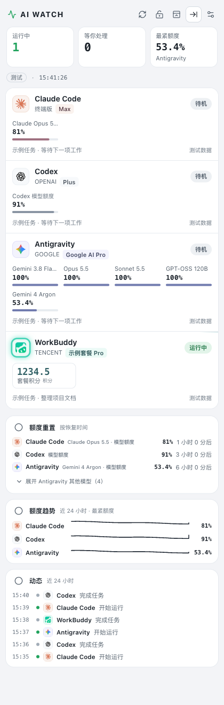
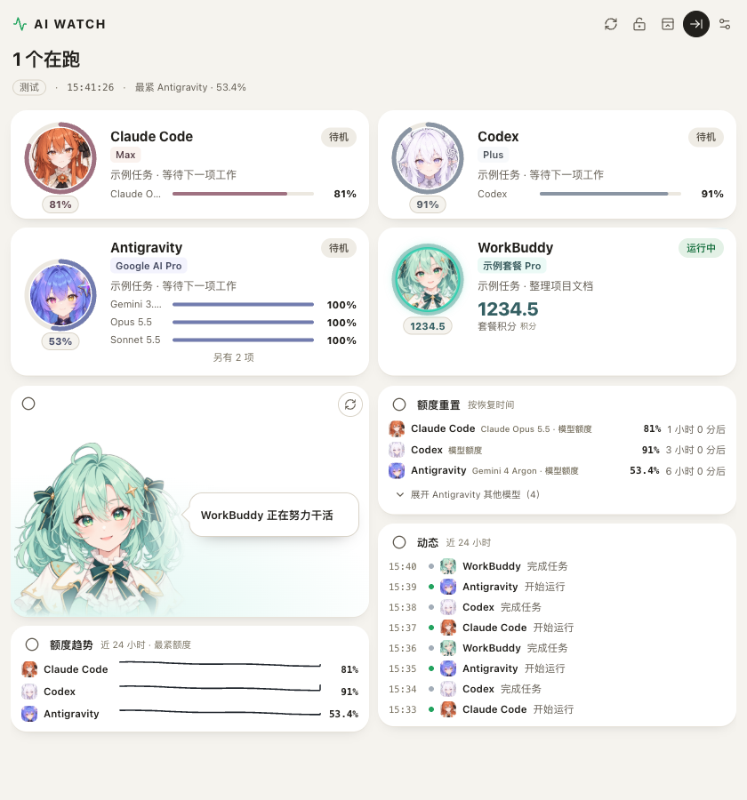
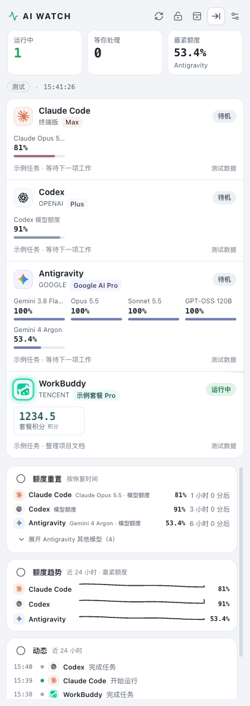
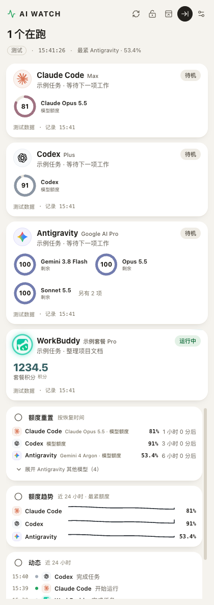
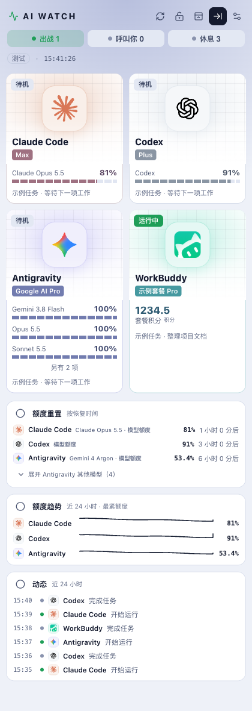

# AI Watch

把多个 AI 助手的运行状态、等待提醒和剩余额度放在一个桌面面板里。支持 Claude、Codex、Antigravity、DeepSeek Harness、ZCode、Kimi、千问和 WorkBuddy；数据来自本机客户端及已接入的只读额度接口。

当前以 **macOS** 为验收平台，使用 Electron、React、TypeScript 和 Vite。Windows / Linux 提供构建入口，实际接入与窗口行为仍待对应平台验证。

## 当前界面

以下为当前界面的 **合成测试数据截图**，不包含真实账户、任务或登录信息。

**单列总览**：固定工具栏和状态总览，助手卡片与下半屏分别滚动。



**双排模式**：下半屏保持两列，每列按组件实际高度紧凑排列；看板娘使用更大的立绘和对话区域。



**三种风格**：值守台、表盘和角色栏共用同一份状态数据，均支持浅色、深色和二次元模式。

  

## 主要功能

| 功能 | 当前行为 |
| --- | --- |
| 八个助手模块 | 自由启用、隐藏与排序；分别显示套餐、额度 / 积分 / 余额及活动状态。Claude 可选 Desktop / Code，Kimi 可选 Code / Work。 |
| 三种界面风格 | **值守台**用紧凑列表与进度条，**表盘**突出额度圆环，**角色栏**使用队伍卡片与分格额度条。 |
| 窗口与收纳 | 单列、双排、全屏任务详情、状态窄条；可置顶、左右停靠或收纳到菜单栏。 |
| 等待与活动提醒 | 总览集中显示需要回答 / 授权的助手；运行光晕、等待提示和屏幕外活动光带帮助定位。可关闭动画，适配系统减少动态效果。 |
| 下半屏 | 动态时间线、额度重置日程、额度趋势及二次元看板娘，可独立开关、滚动和拖动排序。 |
| 水冷小屏幕串流 | AI Watch 内置功能，适配 Windows x64 与 macOS 15+（Apple Silicon / Intel）的展域 / TRYX PANORAMA SE（PASE_1021）USB 屏。左右 1:1 曲面分区：左侧四个 Agent，右上看板娘、右下额度历史；提问 / 授权使用左角色、右红字全屏提醒。Mac 移植尚未发布，实体 USB 仍待验收。 |
| 外观与语言 | 跟随系统或手选明暗主题；17 种语言，含阿拉伯语 / 希伯来语 RTL。普通 LOGO 与二次元图片可分别替换。 |
| 本地保存 | 保留模块、顺序、风格、来源、图片等偏好；动态和趋势只保存在本机。缺失数据明确显示未知，历史数据单独标记。 |

### 窗口和日常操作

在 **配置 → 外观 → 窗口模式** 选择布局。单列宽度随屏幕可用高度变化，限制在 300–420 逻辑像素；双排宽度加倍，受屏幕可用宽度限制。卡片按内容决定高度，顶部工具栏和总览固定。

- **单列 / 双排**：上方卡片和下半屏各自滚动，所有开启的组件都可查看。双排下半屏固定两列，后续组件紧接所在列的上一块，不因旁边较高的组件留下整行空隙；展开模型或更多动态后会重新排布。看板娘排在最后时（默认顺序）固定在双排 / 全屏下半屏最底部并横跨所有列；把它排到其他位置后按普通组件参与分列，键盘 Alt + ↑ 可把底部的看板娘上移一格回到分列中。
- **全屏**：显示更宽的助手卡片与每个助手最多八条任务详情；只有客户端提供的名称、时间、操作摘要或进度才会显示。点击退出全屏或按 Escape 返回此前布局。全屏期间暂停跨桌面置顶。
- **收起**：缩为 64 逻辑像素宽的状态窄条，保留已启用助手的图标和状态。**收纳**则隐藏窗口与 Dock 图标，后台继续监看；点击菜单栏图标可看额度速览或恢复面板。
- **打开助手**：点击卡片 / 窄条头像或看板娘立绘。未识别到应用时，在 **配置 → 图片与应用 → 启动应用** 手动选择；头像也支持 Tab、Enter 和空格操作。
- **移动与排序**：拖动顶部移动整个窗口。卡片非按钮区域长按约半秒后拖动排序；下半屏从圆圈手柄直接拖动，靠近滚动区边缘会自动滚动。按 Escape 取消，也可聚焦卡片或手柄后用 Alt + 方向键调整。隐藏组件保留原顺序。
- **完全退出**：关闭窗口会收纳；通过菜单“退出 AI Watch”、配置“退出面板”或 `⌘Q` 停止后台监看。macOS 快捷键：`⌘⇧B` 展开 / 收起，`⌘⇧H` 收纳，`⌘⇧U` 额度速览。

**配置 → 关于** 只显示版本号、项目 GitHub 地址（点击用系统浏览器打开）和作者：Claude大小姐 · GPT龙娘。

外观、语言、模块和来源选择即时保存。首次启动按配置贴边；本次运行中可移动到其他屏幕，重启后回到默认停靠侧。菜单栏额度速览使用最近的后台快照，不会因打开菜单额外查询账号。

### 下半屏和看板娘

在 **配置 → 外观 → 下半屏** 开关各组件。关闭全部组件后，助手卡片列表使用完整可用区域。

| 组件 | 显示内容与展开方式 |
| --- | --- |
| 动态 | 已显示助手的开始、等待、完成、启动和退出记录，最新在上。默认最近 **50 条**，点击“展开更早动态”查看其余记录；本机最多保留近 24 小时的 300 条。 |
| 额度重置 | 按恢复 / 到期时间排序。Antigravity 默认只显示 **Gemini 4 Argon**，其他模型手动展开；Argon 没有有效未来重置时间时，回退到该助手最早恢复的一项。其他助手最多保留 7 项，没有 Antigravity 时为 8 项。 |
| 额度趋势 | 近 24 小时每个助手“最紧额度”的变化；需要积累至少两个采样点。 |
| 看板娘 | 仅二次元模式显示，优先提示等待处理、运行或额度紧张。点击右上角刷新按钮换一位已显示的助手说话；双排模式放大人物与气泡。 |

模型和动态展开后可以再次收起，重新打开应用默认收起。动态和趋势仅记录助手编号、状态、时间与百分比，不含任务内容；重启从新基线继续，不补造应用关闭期间的记录。双排的列高会随内容变化调整，下半屏使用统一滚动区域。

看板娘提供 **8 位助手各 150 条，共 1200 条中英台词**；中文界面用中文，其余语言用英文。多位助手时避免连续选同一位，近期台词尽量不重复；状态变化会切回提示。默认每 **15 秒** 自动换句，可关闭或设为 **5–300 秒**，底部进度条表示下一次刷新的时间。有助手工作时，每三句闲聊插播一次工作状态；手动换句重置倒计时，打开配置或拖动下半屏排序时暂停。

二次元图片会按用途裁成头像或半身像，普通 LOGO 与角色图独立保存。WorkBuddy 使用薄荷绿双马尾原创生成立绘，来源分类为 `generated-edit`，尺寸与提示词见[素材说明](docs/WORKBUDDY-ART.md)。自选图片支持 8 MB 内的 PNG、JPG、WebP，仅保存于本机；已有自选图优先于内置图片。

### 水冷小屏幕串流（Windows / macOS 15+）

这是 **原 AI Watch 的可选功能**，默认关闭，沿用原应用名称、配置目录和安装包。基于 XANALI 的展域传输代码，当前适配 `zhanyu` / PASE_1021；其他设备需新增适配器，不能仅更改设备名称使用。

在 **配置 → 小屏幕串流** 设置分辨率、帧率、码率、模块轮播间隔和看板娘，然后开启。默认 **2240 × 1080、30 FPS、8 Mbps**。连接前退出占用设备的 KANALI（包括 Screen.exe / UDB.exe）。启用后桌面显示串流参数和原有配置，仍可折叠为侧栏、最小化或收纳到托盘；关闭串流会恢复此前的桌面布局，并等待屏幕原厂界面恢复。

Mac 需要 **macOS 15 或更新版本**及匹配芯片的构建：M 系列使用 arm64，Intel 使用 x64。USB 直接连接 Mac；部分 Apple Silicon 笔记本会询问是否允许连接配件，请在解锁状态下允许。若接口被其他程序或系统驱动占用，设置页会提示错误；程序不会强制卸载驱动。串流只渲染 AI Watch 自己的页面，不需要屏幕录制权限。电脑系统睡眠期间不能保证持续串流。

- 当前 90° 曲面屏按展开画布 **左右 1:1** 分区，中间留出弯折间距。左侧每页四个 Agent（2×2），右上为原版看板娘及台词，右下为额度历史曲线。原生 2240×1080 的两侧分别接近正方形；半尺寸和方形画布也保持左右区域。复用三套皮肤、明暗主题和动效，超过四个 Agent、模型额度、积分和币种自动轮播。
- 左侧卡片按上下分区：上半放大头像并显示名字、套餐和状态，下半集中展示额度；圆环皮肤扩大头像与外环，保留呼吸光效。
- 额度历史显示近 24 小时各 Agent 的最低剩余百分比，每页最多四条曲线，跟随已有本机记录或 LAN 主客户端历史。单点只显示点，没有历史时显示“记录中”；不把余额、缺失值或历史不足补成零。关闭看板娘后曲线占满右侧。
- 小屏移除打开程序、排序、手动刷新、手动翻页等控件；串流期间主进程也拒绝打开程序、重排和手动刷新请求。原有参数、来源、图片、主题及同步配置仍可在桌面调整。
- 看板娘复用原版 **1200 条中英台词**、表情和状态播报，自动换句间隔沿用 **外观 → 下半屏**。小屏独立运行，桌面配置页打开、最小化或收纳都不会暂停台词；关闭自动刷新时仍显示状态台词。
- 当前提问或授权请求全屏显示：**左半角色、右半大号红字**，文字向右留出约一个大字的额外间距。多条提醒每 6 秒自动切换，角色和文字滑入淡入，底部显示轮换进度；有当前等待任务明细时，同一 Agent 的多条任务也分别展示。缺少明细时按 Agent 汇总，同时待回答和待授权分两行显示。普通状态刷新不重置轮换，关闭动效仍会换页；处理完成后恢复监看布局。过期任务、登录提示和辅助功能权限提示不会仅凭文字触发全屏提醒。仍需在电脑上的对应 Agent 中回答或授权。
- 局域网子客户端可将主客户端的状态显示到本机小屏；测试模式会同步到小屏并标为测试数据。系统减少动态效果和原有动效开关仍有效。

Windows 离屏渲染及无 USB 编码验证已通过；Mac Apple Silicon / Intel 均已通过原生构建、严格签名、离屏编码及打包应用启动检查。**实体展域设备的显示、帧率与退出恢复尚待实机验收**。构建、依赖准备、架构和验证范围见 [小屏幕串流说明](docs/SCREEN-STREAM.md)和[桥接组件资源](screen-bridge/README.md)。

发布流程从固定的 FFmpeg / x264 源码构建编码器，再构建并打包内部串流桥；Mac 额外包含固定源码构建的 libusb。Apple Silicon 与 Intel 分别原生构建，完整对应源码、构建脚本与许可证随包保留。CI 先完成不连接 USB 的真实编码检查，再检查安装包中的组件。缺少组件的自定义构建仍会禁用串流开关并说明原因。已发布的 **v0.20.0 Mac 包不含这次 Mac USB 移植**，需使用本分支的新构建。

### 测试模式

在 **配置 → 模块 → 测试模式** 选择合成的运行、待机、等待、低额度、历史值等场景，再查看测试面板。界面明确标为“测试模式”；不会启动 AI 任务、回答问题或批准授权。测试开关仅在当前界面会话有效，退出后恢复已收到的本地状态；桌面菜单栏继续显示后台实际数据。窗口与图片设置仍会正常保存。

### 多端同步（局域网）

在 **配置 → 多端同步** 选择本机角色，默认“独立”，不开任何端口。

- **主客户端**：在局域网内共享助手状态、额度、等待提醒、动态与趋势记录，显示 6 位配对码、本机局域网地址和端口（默认 47321，可改为 1024–65535）。首次开启时 macOS 可能询问是否允许 AI Watch 接受传入连接，请选择允许。
- **子客户端**：点击“搜索局域网主客户端”（UDP 47322 广播发现），或手动输入 `地址:端口`，再输入配对码即可连接。连接后停止读取本机助手，只显示主客户端的数据；顶部标签显示“同步 / 未同步”，断线后自动重连。外观、语言、布局和看板娘间隔仍按本机设置；打开应用、授权辅助功能等需在主客户端操作。
- **安全边界**：只接受局域网与本机回环地址，拒绝带浏览器来源的请求；配对码只用于一次换取随机长令牌，主客户端只保存令牌摘要，连续输错会被限流。同步内容会去掉凭据、密钥、本机路径等字段，不同步自选图片、启动应用路径和钩子配置。“重置配对码并断开所有设备”会让所有子客户端失效。连接为局域网明文 HTTP，请只在可信网络中使用。

## 数据来源与限制

先在本机正常安装并登录所需客户端，再打开面板。不同服务的额度、积分和金额保留各自单位，不相加为一个总量。套餐和额度分别判断：未知不等于 Free，额度用完不改变套餐，历史数值不代表当前可用。

| 模块 | 额度 / 套餐 | 活动与主要限制 |
| --- | --- | --- |
| Claude Desktop / Code | 匹配所选来源和账号的本地快照；可选使用已有登录联网查询 | Code 会话登记与可选状态钩子；登记文件中的“待授权 / 待回答”优先于辅助功能提示。普通桌面聊天依赖 macOS 辅助功能。两种来源隔离，不混用账号。 |
| Codex | 官方客户端账号额度接口，失败时使用明确标记的缓存或本地记录 | 本机桌面任务及等待通道，支持普通 / 异步提问、选项选择、命令 / 文件 / 权限授权。等待时优先显示红色“待回答 / 待授权”，处理后恢复；其他任务仍独立计数。API Key 登录没有订阅额度；独立 CLI、远程或未加载的任务可能不可见。 |
| Antigravity | 已运行客户端的本机语言服务接口 | 读取服务任务状态；接口属于客户端内部实现，升级可能影响兼容。未运行时不会用历史运行标记点亮状态灯。 |
| DeepSeek Harness | 已有账号登录态查询官方余额，分别显示 CNY / USD、现金与赠送金额 | 结合 v4 会话事件、存活进程和会话锁判断；格式、记录或进程证据不足时显示未知。 |
| ZCode | BigModel 个人 Coding Plan 的已有登录与套餐 Key | 本地回合遥测需要观察到新活动；等待状态暂不可区分。团队等其他套餐、自定义目录尚未接入。[说明](docs/ZCODE-INTEGRATION.md) |
| Kimi Code | 已有文件型 OAuth 登录对应的官方额度 | 经验证的本机服务可读取运行 / 等待；普通终端与旧 CLI 活动可能未知，真实账号额度和状态变化仍待专项验收。[说明](docs/KIMI-INTEGRATION.md) |
| Kimi Work | 正在运行的桌面客户端账号与会员共享积分 | 活动暂为未知；已验证 macOS 国内账号和默认目录。[说明](docs/KIMI-WORK-INTEGRATION.md) |
| 千问 | 桌面客户端已有登录与官方会员接口 | 需手动开启千问专属钥匙串读取；本地智能体活动可观察，普通聊天 / 云端 / 等待暂不可确认。真实积分响应仍有兼容限制。[说明](docs/QWEN-INTEGRATION.md) |
| WorkBuddy | 官方客户端本机 WBIPC 通道的套餐与资源摘要 | 已验证套餐和积分；活动依据当前账号记录的近期变化，首次采样、陈旧数据及等待授权保持未知。[说明](docs/WORKBUDDY-INTEGRATION.md) |

Codex 等待提醒直接读取当前桌面客户端的只读状态流，支持旧式 `turns` 和新的 canonical history。大型状态快照逐段解析，只缓存请求类别、问题数量及回答匹配所需的哈希；不缓存对话正文、问题选项、工具输入输出或授权命令。等待变化直接更新面板、菜单栏和小组件摘要，不等待额度查询完成。首份快照或修订丢失后会重订阅，旧消息不会重新点亮已处理的提醒。

该通道当前核对的是 macOS 客户端 v11 协议，只监看本机候选列表中的最多 32 个会话，已知等待优先保留。线上单帧最多 256 MiB，保留投影预算及每会话状态序列化上限各为 2 MiB，并限制节点 / 深度；超出资源界限或协议不兼容时等待通道可能不可用，不据此推断没有请求。Windows 尚未接入这个 Unix socket 等待通道，Linux 仍待实机验证。

Antigravity 主卡片将同一基础模型的 High / Medium / Low / Thinking 合并显示；值守台显示全部，表盘和角色栏显示前三项，悬停“另有 N 项”查看剩余内容。这与下半屏重置日程的 Argon 默认折叠分别生效。更多套餐边界见[套餐接入说明](docs/PLAN-INTEGRATION.md)。

**Claude 的可选入口**均在配置的数据来源中：

- **联网查询 Claude 额度**默认关闭，复用所选客户端的已有登录，只读查询官方套餐和额度；可能需要 macOS 钥匙串授权。不会自动登录、续期令牌或使用 API Key。依赖内部接口与当前登录格式，接口和服务政策变化可能影响使用，详见 [Claude 凭据使用说明](https://code.claude.com/docs/en/legal-and-compliance#authentication-and-credential-use)。
- **Claude Code 状态钩子**默认关闭，开启后向 Claude Code 用户设置登记面板脚本，关闭时只移除本面板拥有的条目。仅记录白名单事件元数据，不读取对话或工具参数，不输出授权决定。真实终端 / 桌面 Code 会话触发链路仍需客户端实测；Windows 暂不支持，Linux 未实机验收。
- **识别桌面活动（辅助功能）**用于普通桌面聊天的发送、停止、提问和授权控件，不读取聊天正文。需要为实际安装副本授权；授权成功不保证客户端所有窗口都能被读取。
- 会话登记会核对进程身份；启动时间明确不匹配时拒绝旧登记，避免 PID 复用误报。身份核对成功的长期 Code 会话不因文件十分钟未更新变成未知；缺少身份或查询失败仍按原有时效处理。真实连续十分钟任务观察尚未完成。

**隐私与可靠性**：OS 访问、登录读取及网络查询集中在 Electron 主进程，通过经过验证的窄 preload 接口向沙盒界面传递摘要。登录凭据不进入界面、日志或仓库；面板不发送任务、不批准授权、不替用户登录。仅在全屏按需读取有限任务标题和操作元数据，不向界面输出完整对话、命令参数或工具输出，退出全屏清除详情快照。自选图片、偏好与本地记录不上传。

数据有各自的采样、缓存与限流周期，刷新按钮不会绕过服务限制。客户端未运行、版本变化、权限不足、记录不完整或网络失败时，面板会显示离线、未知、历史或错误说明；额度读取成功并不能证明任务正在运行。已验证范围和历史未完成项分别记录于 [QA](docs/QA.md) 与 [Agent Log](Agent%20Log.md)。

## 安装包与发布

版本 **0.20.0** 新增 Windows 展域小屏幕串流、曲面布局、额度历史和等待提醒轮播，保留局域网同步与原有 macOS 桌面功能。从项目的 [GitHub Releases](https://github.com/Andromedahk/ai-watch-panel/releases) 下载与系统匹配的安装包：

| 平台 | 文件 | 安装方式 |
| --- | --- | --- |
| macOS Apple Silicon | `AI-Watch-0.20.0-mac-arm64.dmg` / `.zip` | 打开 DMG 并将应用拖入 Applications，或解压 ZIP。 |
| macOS Intel | `AI-Watch-0.20.0-mac-x64.dmg` / `.zip` | 同上，选择 x64 包。 |
| Windows x64 | `AI-Watch-0.20.0-win-x64.exe` | 运行 NSIS 安装程序；安装结束后手动启动。 |

Release 同时提供 `SHA256SUMS.txt`，用于核对下载文件。macOS 普通包为 ad hoc 签名，**没有 Developer ID 签名和 Apple 公证**，首次打开可能受到 Gatekeeper 限制；Windows 包**没有 Authenticode 签名**，可能出现 SmartScreen 提示。请核对项目来源及校验值后按系统提示处理，不建议全局关闭系统保护。原生桌面小组件不在普通安装包内。

Windows 原生 CI 已完成构建、NSIS 安装和合成数据下的打包应用启动检查；各助手的真实服务、辅助功能和完整窗口交互仍待 Windows 实机验收。Linux 本次不发布。已发布 v0.20.0 的 macOS 原生辅助程序以 macOS 13 为部署目标，旧版本系统的完整兼容性尚未另行验收；本分支新增 USB 串流的 Mac 构建改为要求 macOS 15+。

维护者在 Actions 中对最新 `main` 手动运行 **Release installers**。`publish` 默认为 `false`，只构建、检查并保存 Actions 产物；需要公开发布时将 `publish` 设为 `true`。发布任务等待三个原生构建任务全部成功，在 GitHub 内部下载同一次运行的安装包、生成 `SHA256SUMS.txt`，并确认远端 `main` 仍指向本次运行的 `github.sha`。随后创建草稿 Release，将标签固定到该提交，上传并核对五个安装文件及校验清单，最后公开。若 `main` 已更新，须针对最新 `main` 重新构建。

仅验证 Mac 移植时可选 `macos_only: true`，Apple Silicon / Intel 两个原生任务会独立运行，不等待 Windows 交叉编译工具安装；该模式始终禁止发布。正式发布必须关闭此选项并完成三个平台的检查。

Release 正文来自 [v0.20.0 发布说明](docs/releases/v0.20.0.md)，来源提交和 CI 链接由工作流运行时附加。正式包仅额外包含一份明确标记的合成状态夹具，供 `npm run test:release -- <应用可执行文件>` 在独立临时配置中检查，不会读写真实账户。

## 本地开发与安装

需要 Node.js 22.16 或更新版本、npm；macOS 完整打包要求 macOS 15+、Xcode Command Line Tools、原生 Python 3.13、Go、pkg-config 和 nasm。串流构建会下载并验证固定上游源码，不需要外部 XANALI 文件夹；准备方法见[桥接说明](screen-bridge/README.md)。仅开发普通面板界面不需要串流构建依赖。

```sh
npm ci
npm run dev       # 界面服务与 Electron 窗口
npm run dev:web   # 仅浏览器预览，窗口和本机能力以桌面版为准
```

```sh
npm run build
npm start         # 启动已构建的桌面版
npm run pack:mac  # 生成当前 Mac 原生架构的 .app（含串流桥）
npm run dist:mac  # 生成当前架构的 DMG + ZIP；两种芯片分别构建
npm run dist:win  # 生成 Windows x64 NSIS 安装程序
```

打包输出位于 `release/`。普通 macOS 本地包使用 ad hoc 签名，尚未提供 Developer ID 签名和公证；更换签名后可能需要为最终安装副本重新授予辅助功能权限。升级前备份旧应用和完整用户数据，完全退出后替换原位置的应用，再启动；保留 `userData` 中的偏好和自选图片。不要覆盖正在运行的应用。

Electron 下载受限时，可复用依赖目录中与版本、架构匹配的发行版：

```sh
npm run build
npx --no-install electron-builder --mac --dir --config.electronDist=node_modules/electron/dist
```

`npm run dist:linux` 准备 AppImage 打包，仍需在对应系统验证。Windows 安装包的构建及启动检查与真实服务验收分别记录。构建、签名或启动成功不代替真实服务与系统能力验收。

面向 AI Agent 的结构化部署规格（目录结构、IPC、偏好字段、数据来源、构建与验证步骤）见 [AGENT-README.md](AGENT-README.md)。

### 验证命令

```sh
npm test
npm run build
npm run test:skins
npm run test:layouts
npm run test:insights
npm run test:codex-attention # 合成 SQLite + 超过 16 MiB 的 IPC + 三皮肤等待 / 恢复
npm run test:corners
npm run test:i18n
npm run test:lan-sync # 两个独立测试配置在本机配对、同步、重连与撤销
```

桌面专项按需运行：`test:desktop`、`test:tray`、`test:motion`、`test:sort`、`test:theme`、`test:modules`、`test:ui`、`test:anime`、`test:credits`、`test:plans`、`test:quotas`、`test:kimi-work`、`test:resources`。完整脚本以 [package.json](package.json) 为准。Electron 界面检查应依次执行，避免原生窗口争抢焦点；默认使用独立配置与合成记录，真实账号专项需要显式开启 `AI_WATCH_LIVE_QA=1`，其截图不应提交。

具体提交的验证结果见下方更新记录和 [Agent Log](Agent%20Log.md)，不把历史通过结果当作当前全部功能已复验。主要代码分布：`src/view/` 为三风格共用界面，`src/journal.ts` 为本地动态与趋势，`electron/` 为窗口、适配器、权限和 preload，`electron/locales/` 为 17 种语言资源。

### 原生小组件：准备中的可选功能

仓库包含 macOS 14+ WidgetKit 扩展及共享摘要桥，**普通 `pack:mac` 不提供可用的桌面小组件交付**。开发构建与合成检查已有记录，但系统图库发现、实际共享容器和系统刷新尚未完成验收，不列作已验证功能。

发布该扩展需要匹配应用标识、签名身份、App Group 与 provisioning profile；仅通过签名校验并不足够。构建、签名、预览与系统验收步骤见[原生小组件开发说明](docs/MACOS-WIDGETS.md)。

## 更新记录

### 维护 · 2026-10-27 · 清理已合并的旧分支 · 署名：Codex（GPT-6 / Codex 桌面本地执行环境）

- 按用户确认，同时删除本地与 `origin` 上最后提交超过 7 天的三个分支：`NewUI`（`fe79e77`）、`codex/multilingual-support`（`bf8da12`）、`codex/layout-modes`（`f8fc5f3`）。
- 删除前复核本地与远程分支头一致、全部提交已包含在 `main`、无工作区占用；远程删除采用预期提交校验和原子操作，本地使用已合并检查删除。
- 删除后刷新远程引用，核实三个本地分支和三个远程分支均已移除。此次为 Git 分支维护与文档记录，未运行应用构建或产品测试。

### 未发布 · 2026-10-27 · macOS 15+ USB 小屏移植 · 署名：Codex（GPT-6 / Codex 桌面本地执行环境）

- 从拉取后的最新 `main`（`2a9f856`）创建 `codex/macos-usb-streaming`，为 Apple Silicon 和 Intel 增加原生 USB 传输，串流继续作为 AI Watch 内置功能。保留原小屏布局、动效、看板娘、曲线和全屏等待提醒。
- Windows 与 Mac 共用设备协议，分别使用原 Windows USB 传输和随包 libusb；Mac 最低版本为 15，不强制卸载驱动或改变设备配置。新增无 USB 的库预检及手工设备信息预检。
- 增加固定源码构建的 Mac FFmpeg / x264 / libusb、Python 桥、架构与签名检查；两种 Mac 架构分别原生构建和验证。使用者无需外部 XANALI 目录或另装运行时。
- [原生 CI 40363505467](https://github.com/Andromedahk/ai-watch-panel/actions/runs/40363505467) 的 Apple Silicon / Intel 均成功：各 568 项 Node 测试、52 项 Python 测试（51 通过、1 项 Windows 专用测试跳过）、Go 检查、固定源码依赖编译、严格签名、真实编码、Electron 离屏链、DMG / ZIP 及打包应用启动检查通过。两种架构安装包保存在该次 Actions 产物中，未公开发布。
- 随包重建源码保留仓库目录结构，优先复用随包上游归档并核对摘要；Python 桥使用默认 ad hoc 签名，避免显式参数意外启用未配置的 hardened runtime。增加仅 Mac 验证入口，发布仍要求完整三平台检查。
- 本地类型检查、网页构建、35 项定向 Node 测试及完整小屏预览通过；最终 52 项 Python 测试中 51 通过，1 项 macOS 文件锁实测因 Windows 主机跳过。Windows 桥重建、真实 H.264 编码和 Electron 离屏链通过；全量 Node 与未修改基线相比新增失败 0。修正 CI 的 Python 测试工作目录，以及原有 Windows 高 DPI 窗口高度的 1 DIP 测试舍入误差。实体 USB 接管、出画、持续运行及恢复仍待实机验收；详细失败与复测记录见 [Agent Log](Agent%20Log.md)。

### 0.20.0 · 2026-10-26 · 正式发布并完成 macOS 升级 · 署名：Codex（GPT-6 / Codex 桌面本地执行环境）

- `codex/liquid-cooling-screen` 已合入并推送 `main`，发布标签 `v0.20.0` 固定到合并提交 `3d50e4a`。[Release](https://github.com/Andromedahk/ai-watch-panel/releases/tag/v0.20.0) 已公开并设为最新版，包含 macOS ARM64 / Intel DMG 与 ZIP、Windows x64 NSIS 安装包和 SHA-256 清单，共六个资产。
- [发布运行 40348971228](https://github.com/Andromedahk/ai-watch-panel/actions/runs/40348971228) 全部成功：固定源码编码器、三个原生平台构建与包启动、macOS 签名/DMG、Windows NSIS 安装后启动、桥及完整源码摘要检查通过。Windows Electron 离屏真实编码产生 164 帧 H.264 / 5,799,581 字节，进程退出 0、无标准错误；未连接 USB。
- 本地最终 558 项 Node 测试、26 项 Python 测试、24 组皮肤、54 项曲面屏及桌面布局/历史/17语言/资源/Codex提醒/LAN同步检查通过。正式 ARM64 ZIP 的摘要、签名、93 个应用文件与隔离启动检查通过。
- 已完全退出旧应用，备份旧应用及完整用户数据，使用正式 Release 的 ARM64 ZIP 替换并启动。安装后的应用资源摘要与发布副本一致，偏好文件升级前后逐字节一致；备份和安装证据仅保存在忽略的 `.local/install-backups/`，未提交用户数据。
- 小屏 USB 串流仍仅用于 Windows，实体设备画质、持续帧率和厂商界面恢复仍待硬件验收；macOS 保留原桌面能力。

### 0.20.0 · 2026-10-26 · 合并小屏串流并准备双平台发布 · 署名：Codex（GPT-6 / Codex 桌面本地执行环境）

- 将 `codex/liquid-cooling-screen` 合入 `main`，版本更新为 0.20.0，保留原有本地操作记录。Windows 新增可选展域串流、左右曲面分区、额度历史、原版看板娘与多任务等待提醒轮播；macOS 保留原桌面功能。
- Windows 发布改为从固定 FFmpeg / x264 官方源码构建编码器，完整对应源码、构建脚本和许可证随串流桥分发；原生 Windows CI 运行资源检查、真实无 USB 编码、应用与安装后烟测。macOS ARM64 / Intel 继续分别构建、检查签名完整性、DMG 和正式应用启动。
- 修正串流模式桌面无法折叠的问题；桌面侧栏、隐藏与展开独立于离屏输出。Python 模拟设备测试消除平台假设，产品仍只允许 Windows USB 串流。
- 验证结果在 [v0.20.0 发布说明](docs/releases/v0.20.0.md) 与对应 CI 记录中列明。实体设备画质、持续帧率和厂商界面恢复仍待硬件验收；Windows 真实服务与 Linux 支持不能由合成烟测替代。

### 未发布 · 2026-10-26 · 保存 Relay 改动并更新 main · 署名：Codex（GPT-6 / Codex 桌面本地执行环境）

- 按人类要求，将当前目录从 `codex/agent-mcp-relay` 切换到 `main`，通过 `git pull --ff-only origin main` 快进至 `4b66a00`，与远端 main 一致。原来占用 main 的干净工作区保留在 `3f6629d`（detached HEAD）。
- 原有 45 个文件的未提交改动（含三份未跟踪文档）完整保存在 stash `7aff77d43622d69a2472c1213e6dd8af13b959b9`；恢复开发前需先保存当前目录的新增改动，再切回原分支并按该标识恢复。本次操作记录保留为本地未提交文档改动。
- 验证：HEAD 与 `origin/main` 一致、记录写入前工作区干净、stash 文件清单与文档空白检查通过；未运行构建、产品测试或安装应用，未推送。

### 2026-10-26 · 小屏串流版本确认与分支提交

- 用户确认当前版本可用，授权提交并推送 `codex/liquid-cooling-screen`，包含串流集成、曲面布局、大头像和全屏提醒轮播。
- 本次提交保留已有验证结果与使用说明，仅包含源码、测试、文档和许可证；构建产物、本机配置与外部运行时资源不纳入 Git。

### 2026-10-26 · 小屏头像放大与全屏提醒转场

- 左侧 Agent 卡片改为上半头像、名字与套餐，下半额度，重点扩大圆环皮肤头像；原桌面三套皮肤布局保持原样。
- 全屏提醒文字向右移动约一个大字，多条等待提醒增加每 6 秒自动轮换、角色与文字入场动画和进度条；支持同一个 Agent 的多条当前等待任务明细。
- 仅在现有 `codex/liquid-cooling-screen` 分支开发，串流仍为原 AI Watch 的内置功能。
- 验证：27 项相关单元测试、24 组原桌面皮肤检查、打包版 54 项小屏布局与轮换检查、LAN 同步及打包启动检查通过。使用隔离配置与合成数据，未连接实体 USB 屏幕。

### 2026-10-26 · 曲面小屏左右分区与额度历史

- 针对当前 90° 曲面屏采用左右等宽布局：左侧四个 Agent 卡片，右侧上半看板娘、下半额度历史，中心预留弯折间距。不同画布尺寸保留相同区域关系。
- 全屏提醒改成左侧对应角色、右侧大号高对比红字；多个等待状态继续轮播并自动清除，原有角色台词和动效保留。
- 小屏曲线读取原有历史，区分本机/远端来源，通过同源消息更新；不让屏幕重复写日志。无历史、单点、过期或异常数据均按实际情况显示。
- TypeScript、历史数据单测、真实 Electron 布局与 LAN 历史同步检查通过；未改变设备分辨率或 USB 协议，实体曲面屏视觉效果仍待实机确认。

### 2026-10-26 · 从最新 main 添加小屏幕串流

- 从远程 `main` 的 `4b66a00` 新建 `codex/liquid-cooling-screen`，保持 main 不变；串流作为 AI Watch 功能加入原设置和 Windows 包，保留三皮肤、LAN 同步、Claude Hooks 与原应用身份。
- 小屏字级根据实际卡片空间计算，自动轮播 Agent、额度和币种；删除小屏交互控件，提问 / 授权全屏提醒。桌面启用后仅保留配置，最小化和收纳继续串流。
- 修复此前原型没有看板娘台词的问题：原型只绘制人物和任务文字，现在复用 main 的完整 Mascot、1200 条中英台词、表情与自动刷新逻辑。
- 验证：TypeScript、生产构建、定向单元测试、真实 Electron 离屏串流流程和桥接编码检查通过；全量 Windows 测试与未修改 main 对比，没有新增失败。实体屏幕仍待验收，详细结果见 Agent Log。

### 未发布 · 2026-10-26 · 新增 AGENT-README · 署名：Claude（Anthropic / Claude App 云端会话，经桌面连接写入）

- 新增根目录 [AGENT-README.md](AGENT-README.md)：以紧凑结构化格式描述项目结构、主进程 / preload / 界面分工、IPC 通道、偏好字段与默认值、各助手本地数据来源、局域网同步协议、本地构建 / 打包 / 安装步骤、验证命令、环境变量与仓库约定；在“本地开发与安装”中加入链接。仅文档变化。

### 0.19.1 · 2026-10-26 · 发布 v0.19.1 并移除 v0.19.0 · 署名：Claude（Anthropic / Claude Code，用户 Mac 上的 Remote Control 会话）

- 按人类要求，从最新 main 运行“Release installers”工作流发布 v0.19.1（多端同步、Codex / Claude 提醒修复、精简 Windows 安装包），并在新 Release 核对通过后删除旧的 v0.19.0 Release（保留 git 标签）。新增 [v0.19.1 发布说明](docs/releases/v0.19.1.md)，更新上文安装包表格。

### 未发布 · 2026-10-26 · 多端同步实机验证并合入 main · 署名：Claude（Anthropic / Claude Code，用户 Mac 上的 Remote Control 会话）

- 人类在局域网内实测：Mac 作为主客户端、Windows（本次交叉构建的 `AI-Watch-0.19.1-win-x64.exe`）作为子客户端，同步正常。随后按人类要求将 `claude/lan-sync`（多端同步、Windows 打包文件范围修正及安装记录）快进合入 main，未重复运行测试。

### 未发布 · 2026-10-26 · Windows 安装包与打包文件范围修正 · 署名：Claude（Anthropic / Claude Code，用户 Mac 上的 Remote Control 会话）

- 按人类要求在 Mac 上交叉构建 Windows x64 NSIS 安装包（`AI-Watch-0.19.1-win-x64.exe`，来源 `claude/lan-sync` 的 `fc23c8c`，未签名，SmartScreen 可能提示），输出在忽略的 `release/` 目录。
- 修正打包配置：原 Windows 文件列表只有一条排除规则，electron-builder 会因此打包整个项目目录；在本机构建时会混入忽略目录中的备份和旧构建。现改为在通用列表中排除 macOS 原生辅助程序、仅在 macOS 配置中加回；Windows 包只含网页构建、Electron 脚本、依赖和合成夹具，macOS 包内容不变。含错误内容的首个 Windows 输出未分发，已立即删除。
- 验证：Windows 包内网页构建与 Electron 脚本与源码一致，主程序为 x86-64 PE，安装器为 NSIS；macOS 试打包仍解出两个原生辅助程序。522 项单元测试、TypeScript 与空白检查通过。未在 Windows 实机安装或启动。

### 未发布 · 2026-10-26 · 安装 029c4a2 · 署名：Claude（Anthropic / Claude Code，用户 Mac 上的 Remote Control 会话）

- 按人类要求推送 `claude/lan-sync`，从 `029c4a2` 构建普通 macOS App（0.19.1），正常退出旧应用、备份旧应用和完整用户数据后替换原安装副本并启动。严格签名检查通过，包内网页构建与 Electron 脚本与源码一致，原生辅助程序与上一安装版一致；新版持续运行，启动前后设置文件逐字节一致。多端同步保持默认“独立”，未监听同步端口。备份保留在忽略目录 `.local/install-backups/`。未合并到 main；两台设备之间的实测尚待进行。

### 未发布 · 2026-10-26 · 局域网多端同步 · 署名：Claude（Anthropic / Claude Code，用户 Mac 上的 Remote Control 会话）

- 新增“多端同步”：本机可设为独立（默认）、主客户端或子客户端。主客户端通过局域网共享状态、额度、提醒、动态和趋势；子客户端用配对码连接后只显示主客户端数据，断线自动重连，外观等设置保留本机。支持 UDP 广播搜索与手动地址，17 种语言新增设置文案。
- 安全：仅局域网 / 回环来源，拒绝浏览器来源；配对码限流并换取随机令牌，主客户端只存令牌摘要；同步前移除凭据、密钥和本机路径；子客户端不能打开应用或申请辅助功能授权。
- 验证：522 项单元测试（含 11 项同步协议测试）、TypeScript、空白检查、构建、新的双实例同步检查及 insights、圆角、i18n、资源、皮肤检查全部通过。尚未在两台真实设备之间实测，也未打包安装。

### 未发布 · 2026-10-24 · 安装 ce6ac44 · 署名：Claude（Anthropic / Claude Code，用户 Mac 上的 Remote Control 会话）

- 按人类要求推送 `claude/desktop-code-prompts`，从 `ce6ac44` 构建普通 macOS App（0.19.1），正常退出旧应用、备份旧应用和完整用户数据后替换原安装副本并启动。严格签名检查通过，包内网页构建与 Electron 文件与源码一致；安装后应用摘要与打包结果一致，新版持续运行，启动前后设置文件逐字节一致。备份保留在忽略目录 `.local/install-backups/`。未合并到 main；修复后的真实桌面 Code 提问 / 授权尚待人类复测。

### 未发布 · 2026-10-24 · Claude 桌面 Code 提问与授权区分 · 署名：Claude（Anthropic / Claude Code，用户 Mac 上的 Remote Control 会话）

- 桌面 Code 会话等你回答问题时显示“待回答 · Claude 在等你回答问题”，等你授权工具时显示“待授权 · Claude 在等你授权工具”，与 Codex 的区分一致；处理后回到运行中或待机。此前两种情况都显示为“待授权”，且卡片和顶部提醒被“辅助功能未授权，桌面状态未知”占据。
- 依据：桌面内置的 Claude Code 在会话登记中写入等待原因（工具授权为 permission prompt，提问为 input needed），面板现在读取这一原因；状态钩子把桌面 Code 的 AskUserQuestion 识别为提问，不再因其同时触发授权请求而记为待授权。辅助功能未授权时，已知的等待状态仍正常显示，“授权辅助功能”按钮保留为次要入口。
- 验证：人类在桌面 Code 中分别触发工具授权和提问，只读记录确认登记文件和钩子事件的实际顺序并据此建立测试。510 项单元测试、TypeScript、空白检查、构建、insights、圆角、i18n 与资源检查通过。未重新打包安装 App。

### 2026-10-24 · 合并 Codex 等待修复并清理分支 · 署名：Codex（GPT-6.1-sol / Codex 桌面本地执行环境）

- 将 `codex/fix-codex-attention` 的 `8b84e30` 以保留两个父提交的方式合入 `main`；仅额外更新 README 与 Agent Log，产品代码和已安装的 0.19.1 修复版一致。
- 推送合并后的 `main` 后，用普通已合并分支删除操作清理本地修复分支。远端预检不存在同名分支，无需远端删除；其他历史分支与工作区保留。
- 验证：祖先关系、无冲突合并、来源产品文件一致性与空白检查通过。沿用修复提交已完成的 492 项单元测试、13 项后端 / 46 项界面检查及 macOS 打包安装验证，本次纯合并与记录更新不重复运行产品测试。公开 Release 仍为 0.19.0。


### 0.19.1（已合入 main，尚未发布 Release）· 2026-10-24 · 修复 Codex 待回答 / 待授权漏报 · 署名：Codex（GPT-6.1-sol / Codex 桌面本地执行环境，含 release_audit、projection_tests、packaged_smoke 子 Agent）

- 复现当前客户端约 29.8 MB 状态快照超过旧 16 MiB 限制后断开整个等待通道的问题，改为分片流式投影；保留内存与帧长度分别设限，正文和工具输入输出不进入状态缓存。
- 识别 canonical / legacy 异步问题、对应回答、选项选择和已知动态输入请求，保留命令 / 文件 / 权限授权及并行运行计数；等待变化直接推送，不被慢额度请求延迟或覆盖。
- 首快照和丢失修订可重试，旧快照与过期 owner 消息不复活旧提醒；snapshot 与 patch 都按状态字段白名单处理，问题 / 回答匹配只保留哈希。
- 验证：492 项单元测试、生产构建通过；真实只读状态流重新收到两个已加载会话、无解码错误，缓存元数据约 155 KB；合成 IPC → 读取器 → Electron 的 13 项后端和 46 项界面检查通过，覆盖三皮肤 × 普通 / 二次元，0 页面错误。打包与本机升级结果见本轮 Agent Log。
- 限制：未把合成等待当作真实授权 / 回答操作；Windows 等待通道、Linux、其他未来协议以及未加载 / 远程会话仍未验收。保留既有大 chunk、默认图标及 ad hoc 签名限制。


### 0.19.0 · 2026-10-23 · 修正草稿 Release 查询 · 署名：Codex（GPT-6 / Codex 桌面本地执行环境）

- 首次自动发布的三个原生构建和包检查全部通过，但上传完成后 REST 按标签读取草稿返回 404，公开发布因此停止。改用支持草稿的 `gh release view` 及其 `isDraft` 字段，保留六个资产的远端大小 / SHA-256 校验和 main 来源检查。
- 本任务创建的未公开草稿和标签会清理后重新生成；安装包从包含该修复的最新 main 完整重建。修复前的上传不视为完成公开发布；最终结果以新运行和 Release 为准。

### 0.19.0 · 2026-10-23 · GitHub 内部发布与可追溯说明 · 署名：Codex（GPT-6 / Codex 桌面本地执行环境，主 Agent 与 packaged_smoke 子 Agent）

- 本地产物下载速度受限，发布流程改为可选 `publish`：默认只保存 Actions 产物；显式开启后，三个构建任务全部成功才在 GitHub 内部完成校验清单、草稿上传和公开发布，并再次检查 `main` 来源提交。
- 新增 `docs/releases/v0.19.0.md` 作为发布正文，保留安装方式、验收范围与签名限制；实际来源 SHA 和 CI 链接由当次工作流附加，避免引用旧构建。
- 此前 Actions 运行 `39933685051` 的 macOS arm64、macOS x64、Windows x64 构建及包检查全部通过；本地正式包启动烟测、圆角与 i18n 检查通过。本次流程更新仍须从最新 `main` 重新运行三个构建任务，记录写入时尚未完成自动公开发布。

### 0.19.0 · 2026-10-23 · 合并功能分支与双平台安装包 · 署名：Codex（GPT-6 / Codex 桌面本地执行环境）

- 将 `claude/next-features` 至 `10bd696` 的七个提交合入 `main`，保留合并历史；其他工作区的 relay 未提交改动不参与。版本从 0.18.1 更新为 0.19.0，新增 macOS arm64 / x64 DMG 与 ZIP、Windows x64 NSIS 的独立原生构建流程。
- `.github/workflows/release.yml` 在各原生平台构建并检查正式应用；macOS 检查 ad hoc 签名与 DMG 完整性，Windows 额外静默安装后检查安装副本。工作流只保存通过检查的安装包，公开 Release 由维护者核对同一提交和 SHA-256 清单后发布。
- `package.json` / `package-lock.json` 同步版本与固定产物命名；Windows 包排除 macOS 原生辅助程序、关闭安装结束自动启动；合成 fixture 明确纳入包，支持隔离烟测。macOS CI 原生辅助程序部署目标设为 13.0。
- 发布前本地验证：451 项单元测试、生产构建、insights 全部 60 项检查通过；Apple Silicon DMG / ZIP 生成、严格 ad hoc 签名和 DMG 校验通过，两个原生辅助程序的两种架构均为 macOS 13.0 最低目标。其余结果见本轮 Agent Log；远端三平台构建及安装结果以同一 main 提交的 Actions 运行与 Release 说明为准。
- 保留既有 Vite 大 chunk 提示；macOS 无 Developer ID 签名 / 公证，Windows 无 Authenticode。真实 Windows 提供商集成、完整桌面交互、旧 macOS 兼容性、Linux 和原生小组件仍未完成验收。

### 未发布 · 2026-10-23 · 发布包启动烟测 · 署名：Codex（GPT-6 / Codex 桌面本地执行环境，packaged_smoke 子 Agent）

- 新增 `node scripts/verify-release.mjs "<打包后可执行文件>"`：macOS 参数指向 App 内的 `Contents/MacOS/AI Watch`，Windows 参数指向 `AI Watch.exe`。用临时独立配置及内置合成数据，验证正式包标识、版本、窗口与八个助手、内置图片及渲染器隔离配置，发生页面错误时失败。
- 语法检查通过；最终发布包的运行结果由对应发布记录补充。该检查不访问真实账户，也不代表提供商集成或 Windows 完整功能已经验收。

### 未发布 · 2026-10-23 · 看板娘固定在双排底部 · 署名：Claude（Anthropic / Claude Code，用户 Mac 上的 Remote Control 会话）

- 双排和全屏下半屏中，排在最后的看板娘不再落在某一列中间，而是固定为最底部的整行，横跨所有列并显示刷新进度条；排到其他位置时仍按原瀑布流分列。Alt + ↑ 将底部看板娘上移一格，拖动排序与拖动期间暂停自动换句保持不变，RTL 镜像正确。
- 修正 insights 验收：改为按实际位置找最底部组件，并逐个确认每个组件的末行都能滚动到可见；新增底部看板娘整行、位于所有列下方、进度条可见，以及底部看板娘键盘上下移动的检查。
- 验证：451 项单元测试、TypeScript、空白检查、构建、完整 insights（35 项布局、3 项立绘、15 项自动刷新、7 项排序）、圆角和 i18n 检查全部通过。未重新打包安装 App。

### 未发布 · 2026-10-23 · 精简“关于” · 署名：Claude（Anthropic / Claude Code，用户 Mac 上的 Remote Control 会话）

- 按人类要求删除“关于”中的数据来源说明、各助手状态明细和显示缩放信息，只保留版本号、项目 GitHub 地址和作者“Claude大小姐 · GPT龙娘”（各语言均不翻译名字）。链接经主进程以固定地址用系统浏览器打开，界面不能传入其他网址。
- 17 种语言删除 6 条不再使用的文案，新增 1 条“作者”文案。
- 验证：451 项单元测试、TypeScript、空白检查、构建、i18n 和圆角检查通过；中文 / 英文 / 阿拉伯语下核对“关于”内容与截图，点击链接只调用一次固定地址、不新开窗口。`test:insights` 在此前提交中已因双排布局用例失败，本次未处理。未重新打包安装 App。

### 未发布 · 2026-10-23 · 双排自适应与文档更新 · 署名：Codex（GPT-6 / Codex 桌面本地执行环境，含 review_masonry、masonry_acceptance、refresh_readme 子 Agent）

- 双排下半屏保持两列，按各组件实际高度紧凑排列；展开 / 收起内容后自适应排布，看板娘扩大立绘与气泡区域。
- README 按当前产品重写功能、使用和限制，替换旧界面截图；删除已经弃用的布局描述，将原生小组件明确列为准备中的功能，修正图片说明中的 WorkBuddy 默认素材与头像裁切描述。全部新截图使用合成测试数据，历史更新记录保留如下。
- 构建及定向检查通过：12 组布局矩阵（60 项）、独立 74 项交互检查，另补测全屏三 / 四列切回双排。连续原生全屏转换曾超时，等待系统过渡稳定后重试通过，失败记录保留；未重复全量验收。
- 已备份旧应用与用户数据，覆盖安装并启动；严格签名及 84 个包内文件检查通过，设置逐字节保留。主目录 relay 改动保持原样，修改另加提交到 `claude/next-features`，不合并 `main`。

<details>
<summary>历史更新记录（按时间倒序，不代表当前功能说明）</summary>

### 未发布 · 2026-10-23 · 下半屏折叠与 WorkBuddy 双马尾立绘 · 署名：Codex（GPT-6 / Codex 桌面本地执行环境，含 reset_rows_helper、reset_toggle_locales、review_move_handle 子 Agent）

- 下半屏排序手柄改为圆圈；Antigravity 重置日程默认仅显示 Gemini 4 Argon，其余模型手动展开；动态默认显示最新 50 条，更多记录手动展开。提供 17 语言展开 / 收起文案，保留原排序、滚动与本机记录范围。
- WorkBuddy 新增薄荷绿双马尾原创生成立绘，按人类反馈保留发型、略微扁平化阴影和高光，替换默认占位头像并用于看板娘；透明 PNG 原生 1254 × 1254，来源及提示词见[素材说明](docs/WORKBUDDY-ART.md)，自选图片继续优先显示。
- 11 项定向单元测试、12 项折叠 / 边界检查、6 种立绘显示组合及构建通过；主 Agent 目视抽查截图。未重复全量验收，非中英文案未经母语审校，Windows / Linux 未实机验证。
- 已备份旧应用与用户数据，覆盖安装并启动；严格签名、84 个包内文件及安装归档核对通过，重启前后设置文件逐字节一致。仅更新 `claude/next-features`，不合并到 `main`。

### 未发布 · 2026-10-23 · 下半屏移动图标对齐 · 署名：Codex（GPT-6 / Codex 桌面本地执行环境，含 review_move_handle 子 Agent）

- 下半屏排序手柄由六点图标换为四向移动箭头，标题行统一垂直居中，修复图标与标题错位。拖动和键盘排序的操作方式保持原样。
- 构建通过；macOS Electron 中查看三皮肤 × 明暗主题 × 普通 / 二次元及 RTL 共 13 种显示组合，图标与标题、副标题中心对齐，0 页面错误。仅确认本次外观，未运行全量功能验收；Windows / Linux 未实机验证。
- 已备份旧应用和用户数据，替换并重启 App；安装包内容、签名和安装归档核对通过，重启前后设置文件逐字节一致。

### 未发布 · 2026-10-23 · 安装 aacebdc 版本 · 署名：Codex（GPT-6 / Codex 桌面本地执行环境，含 install_preflight_next 子 Agent）

- 按人类要求，将 `aacebdc` 推送到 `origin/claude/next-features`，从该提交构建普通 macOS App，备份旧应用和完整用户数据后替换原安装副本并启动。重启前后设置文件逐字节一致，备份保留在忽略目录 `.local/install-backups/`。
- 构建、打包及安装所需的严格签名与归档一致性检查通过；新版原位置主进程正常运行。首次推送遇到 TLS 连接中断，重试后成功。按要求未再运行单元测试、界面或真实会话验收；此前记录的未验证事项保持不变，未合并到 `main`。

### 未发布 · 2026-10-23 · 看板娘自动刷新与 1200 条台词 · 署名：Claude（Anthropic / Claude Code，用户 Mac 上的 Remote Control 会话）

- 看板娘新增自动刷新：默认 15 秒，可在 外观 → 下半屏 关闭或设为 5–300 秒，非法值回退默认；底部进度条显示倒计时，换句带入场动画。有助手工作时按“3 句闲聊 + 1 次工作状态”的节奏播报，并轮换介绍运行中的助手。新增 17 种语言的设置文案。
- 台词从 240 条扩充到 1200 条（8 位助手 × 150 条，简体中文 + 英文，中英文各自无重复），加入少量二次元梗。
- 验证：446 项单元测试、TypeScript 检查、空白检查、构建、insights 验收（含 15 项自动刷新检查）、圆角审计和 i18n 检查全部通过。仅在本机 Playwright 测试页验收，未重新打包安装 App；Windows / Linux 未实机验证。

### 未发布 · 2026-10-23 · 当前版本合并到 main · 署名：Codex（GPT-6 / Codex 桌面本地执行环境，含 verify_main_merge 子 Agent）

- 按人类要求，将 `claude/ui-redesign` 截至 `908896e` 的 19 个提交合入 `main`，保留全部原提交历史；涵盖三皮肤界面、Claude 状态修复、下半屏滚动与排序、看板娘换句及最新立绘背景修复。
- 合并无冲突，除 README 与 Agent Log 的本次记录外，文件内容与已验证并安装的 `908896e` 完全一致；沿用原测试和 macOS 显示检查结果，本轮未重复功能验收或重新打包。其他工作区未提交的 relay 改动未参与合并；此前未验证事项保持原记录。

### 未发布 · 2026-10-23 · 看板娘立绘背景修复 · 署名：Codex（GPT-6 / Codex 桌面本地执行环境，含 review_mascot_background 子 Agent）

- 修正看板娘清底样式的优先级，避免继承普通二次元头像的渐变背景、在立绘后方出现突兀矩形。保留原人物图片、渐隐遮罩和普通头像样式。
- 构建通过；macOS Electron 专项检查三皮肤 × 明暗主题 × 中文 / RTL × 普通 / 悬停，共 24 种状态全部通过，普通头像背景未变；截图对比确认矩形底色消失。本轮仅验收该显示修复，未重复全量功能套件，Windows / Linux 未实机验证。
- 已打包、备份旧应用及完整用户数据，替换已安装 App 并重启；严格签名、包内构建内容和安装归档一致性检查通过，重启前后设置文件逐字节一致。构建及备份只保留在忽略目录。

### 未发布 · 2026-10-23 · 安装已审查版本 · 署名：Codex（GPT-6 / Codex 桌面本地执行环境，含 verify_install_bundle 子 Agent）

- 按人类后续授权，将已审查并推送的功能提交 `71a70eb` 打包为普通 macOS 应用，替换原安装副本并重启；本轮仅补充安装记录，不改功能代码。
- 构建和打包通过，整包严格签名、业务源码与网页构建内容核对通过；旧应用和完整用户数据已备份到忽略目录 `.local/install-backups/`。安装归档与核对后的包一致，原位置仅一个新版主进程运行，重启前后偏好文件逐字节一致。
- 沿用上一轮 442 项单元测试、37 项界面检查及圆角审计结果，本轮未重复功能验收。原生小组件、真实连续十分钟 Code 任务及其他平台的未验证边界保持原记录。

### 未发布 · 2026-10-23 · 两提交审查修复与下半屏排序 · 署名：Codex（GPT-6 / Codex 桌面本地执行环境，含 review_claude_status、review_mascot_logic、refresh_drag_acceptance 子 Agent）

- 保留 Claude 的 `f7cf933`、`0490e4f`，追加审查修复：看板娘按真实状态结束旧闲聊，切回原状态不会复活旧台词；语言切换保留当前台词并显示对应中英文；候选助手优先使用未说过的近期台词，单助手耗尽台词后避免紧邻重复。修复三皮肤 300px 窄窗中长英文与刷新按钮重叠、气泡底部裁切，组件随内容增高并预留顶部控件区。
- 修复已验证启动身份的长 Code 会话在全屏任务详情中仍被十分钟规则降为未知的问题；保留真实更新时间。系统明确证明启动时间不同的旧登记不再按近期文件接受；缺少启动身份或查询失败时仍回退原文件时效，hook 保持原来的严格启动身份及事件时效。隔离 logger 回归用例继承的 `CLAUDE_CODE_ENTRYPOINT`。
- 下半屏新增独立排序手柄、拖动边缘自动滚动、Escape 取消及 Alt + 方向键移动；严格校验并保存完整 `insightOrder`，旧配置自动使用原顺序，普通模式或关闭组件时保留隐藏槽位，重启及其他偏好修改后顺序保留。17 种语言补齐手柄说明，不改助手卡片排序。
- macOS 验证：全量 Node 测试 442 / 442 通过，无失败或跳过；构建通过；扩展 `test:insights` 的 37 项通过（16 布局、3 立绘、11 换句、7 排序），覆盖三皮肤、普通 / 二次元、真实点击 / 拖动、窄英文 / RTL、状态恢复及冷重启；加入真实换句后的 `test:corners` 完整通过。构建仍有既有大 chunk 提示，结果与截图在忽略目录；详细计数、审查及失败复测见 [Agent Log](Agent%20Log.md)。
- 本轮仅提交推送当前分支，不合并主分支、不打包或替换已安装 App。真实连续运行超过十分钟的 Claude Desktop Code 会话未完成实测；Windows / Linux 未实机验收。

### 未发布 · 2026-10-23 · Claude 桌面 Code 长任务识别 · 署名：Claude（Anthropic / Claude Code，经 Remote Control 在人类的 Mac 上执行）

- 修复 Claude Desktop 的 Code 模式会话运行超过 10 分钟后显示“状态未知”：Claude Code 只在状态变化时更新会话登记文件，长任务期间修改时间不变。现在当登记中的进程启动时间与存活进程一致时，直接采用其 busy / waiting / idle 状态；无法核对时保留原有 10 分钟规则。任务详情在无标题时回退显示会话名。
- 验证：新增 4 项单元测试；全部 Node 测试、构建与 `test:insights` 通过。未打包安装。

### 未发布 · 2026-10-23 · 看板娘刷新台词 · 署名：Claude（Anthropic / Claude App 云端会话，经桌面连接写入本 worktree）

- 看板娘面板右上角新增刷新按钮：每次点击随机换一位已显示的助手出场，并说一句符合各自人设的台词。台词库 `src/view/quips.json` 共 240 条（8 位助手各 30 条），每条含简体中文和英文；按钮会避开同一位助手连续出场，并在最近 60 条内尽量不重复。
- 有助手等待授权、开始运行或额度变化时，气泡自动切回状态提示，提醒优先于闲聊。从右到左语言中英文台词保持从左到右显示。按钮说明“换一句”同步 17 种语言。
- 验证：`tsc --noEmit`、`vite build` 通过；新增 `tests/mascot-quips.test.cjs`（数量、双语、长度、去重）与 `tests/i18n.test.cjs` 通过；Linux 云端 Chromium 预览中三种皮肤、中 / 英 / 阿拉伯语、单列与宽布局下点击 12 次，按钮不遮挡气泡，无页面错误。未在 macOS Electron 中运行 `test:insights` / `test:corners`。

### 未发布 · 2026-10-23 · 下半屏完整滚动与看板娘定位 · 署名：Codex（GPT-6 / Codex 桌面本地执行环境，含 insights_acceptance、insights_locales 子 Agent）

- 下半屏保留所有已开启组件，提供独立的上下滚动区域，支持滚轮、触控板及聚焦后的键盘滚动；全部八个助手开启或窗口较短时仍可查看，关闭全部下半屏组件后不占空间。时间线、日程和趋势按内容高度显示，取消列表底部裁切与渐隐；宽布局自动多列换行。
- 修正双排 / 全屏看板娘立绘定位：保持与单列一致的尺寸并贴底，移除宽布局放大及对不定高度的依赖，避免头顶被裁切，保留气泡空间。设置说明同步更新全部 17 种语言。
- 仅验收本次新功能：构建通过，`npm run test:insights` 通过 16 组布局及 3 组立绘定位检查，包含三皮肤、普通 / 二次元、高矮窗口、滚轮 / 键盘、开关保存、宽网格、RTL 与原生全屏；主 Agent 已目视双排 / 全屏最终截图。未运行其他验收套件，Windows / Linux 仍待实机验收。
- 普通 macOS 应用已打包，备份旧应用和完整用户数据后替换并正常重启；安装归档与构建一致，重启前后偏好摘要一致。截图、结果与安装备份均留在忽略目录，初轮脚本问题及修正见 [Agent Log](Agent%20Log.md)。

### 未发布 · 2026-10-23 · 安装 Claude 已完成功能 · 署名：Codex（GPT-6 / Codex 桌面本地执行环境）

- 按人类要求以 `claude/ui-redesign` 的 `18c5c6a` 为功能版本打包安装，包含入场动效重播、下半屏四块面板及圆角特效修正；本轮仅补充交付记录，不修改功能代码。
- macOS 构建与普通应用打包完成，保留既有大 chunk 提示；完成安装所需的签名检查、旧应用与完整用户数据备份，退出旧进程后替换原安装副本并正常重启。安装归档与构建产物一致，重启前后偏好文件摘要一致；备份位于忽略目录 `.local/install-backups/`。
- 按人类要求不做二次验收：未重跑单元测试、界面检查或真实客户端会话验收；本次构建、安装和启动记录不替代 Claude 原有验证记录，也不表示此前未验证事项已通过。Windows / Linux 仍待实机验收。

### 未发布 · 2026-10-23 · 圆角与特效配对修正 · 署名：Claude（Anthropic，Claude App 云端会话）

- 头像光环改为贴着头像边缘、用阴影向外扩展，外圈圆角随之同步放大，不再出现外圈转角比头像更方的情况；Antigravity 彩色光环的圆角改为头像圆角加 2px（各处头像设置 `--r`）。
- 表盘卡片运行中顶边的扫光改为整卡图层上的 2px 背景，由卡片圆角裁切，不再在左上 / 右上转角露出直角。
- 看板娘面板改为按自身圆角裁切，立绘不再以直角盖住面板圆角；跳动幅度相应减小。
- 新增 `test:corners`（`scripts/verify-corners.mjs`）：在三种风格 × LOGO / 二次元 × 浅 / 深色、悬停、双排、全屏、入场动画中途、配置面板、等待状态、下半屏和收起栏中，逐个检查绘制在圆角元素上的子元素与伪元素是否越过圆角，以及外圈光效是否同心。

### 未发布 · 2026-10-23 · 下半屏：动态时间线、额度重置日程、额度趋势与看板娘 · 署名：Claude（Anthropic，Claude App 云端会话）

- 窗口较高时，卡片下方的空位可显示四块面板，在“配置 → 外观 → 下半屏”逐项开关：动态时间线、额度重置日程、额度趋势、看板娘（仅二次元模式）。
- 面板只使用卡片下方的空位，不压缩卡片；空间不足时按优先级逐个隐藏，双排 / 全屏时并排显示，并随刷新与切换风格一起重新入场。
- 新增 `src/journal.ts` 记录状态变化与最紧额度采样，只保存助手编号、状态、等待原因、时间与百分比，近 24 小时、本机存储；短时间来回切换的状态会合并。测试模式使用独立示例记录。
- 新增偏好 `insights` 及 `panel:insights` IPC（严格校验四个布尔值），17 种语言补齐 39 条文案；新增 `test:insights` 与偏好单元测试。
- Linux 云端验证：类型检查、构建、408 项单元测试（398 通过、10 项按平台跳过、0 失败），`test:insights` 与其余 16 个界面验收命令通过（`test:motion` 同上次一样跳过 Linux 下无法出帧的收纳冻结项）。尚需在 macOS 上完整复跑并确认实际观感。

### 未发布 · 2026-10-22 · Agent 模块入场动效重播 · 署名：Claude（Anthropic，Claude App 云端会话）

- 首次打开、点击刷新、切换界面风格 / 布局 / 二次元模式、从菜单栏或托盘重新打开面板时，各 Agent 模块都会按顺序重新入场；额度条、圆环和总览数字一起重新生长。
- 三种风格各有入场方式：列表行由一层面板色幕布从顶边向下揭开，表盘先模糊发亮再聚焦，角色栏从起始侧擦出（从右到左语言自动镜像）。
- 幕布是卡片的伪元素，卡片本身只改变透明度与滤镜，因此屏幕外尚未轮到的卡片保持真实位置和可见性判定，滚动到可见时才播放；关闭“状态灯动画”或开启“减少动态效果”时幕布不显示。
- 新增 `src/motion.ts`，通过把入场动画时间轴拨回 0 来重播，不调用播放 / 暂停，屏幕外与收纳时的暂停规则保持有效。`test:motion` 增加刷新、切换风格 / 布局 / 模式和重新打开时的重播检查。
- Linux 云端验证：类型检查、构建、407 项单元测试（397 通过、10 项按平台跳过、0 失败）与 16 个界面验收命令通过；`test:motion` 中“收纳后按钮暂停”一项在 Linux 虚拟显示下隐藏窗口不再出帧，未改动的基线同样失败，因此该项在云端跳过后其余全部通过，需在 macOS 上完整复跑。

### 未发布 · 2026-10-22 · macOS 最终验收、钩子修复与安装 · 署名：Codex（GPT-6 / Codex 桌面本地执行环境）

- 基于 `69eec45` 修复状态钩子：用内置运行时解析顶层 JSON 白名单，避免嵌套内容误入日志；用实际所属进程、启动时间与会话登记核对身份，退出进程和复用编号不会冒认旧会话。同一会话按子 Agent、工具调用和输入请求保持等待，普通通知不延长时效，子 Agent 不覆盖根会话身份或来源。
- 安装和移除只匹配面板在指定位置登记的完整命令；检测设置文件的并发变化后拒绝覆盖，并保留文件权限。最后检查与替换在本进程内同步执行，但不提供跨程序事务锁。
- 修复键盘排序时焦点沿父级滚动导致工具栏上移 1 像素的问题：外壳使用 `overflow:clip`，内部列表和配置区域继续滚动。
- 新增 `test:motion`，覆盖三皮肤、87 次独立可见性观察、42 项动效检查及 6 次主题切换的首帧采样。等待动画 `ready` 与原生窗口显示后再检查，不放宽冻结差值或全屏超时。资源验收逐事件核对 13 条钩子命令；小组件重启检查等待实际窗口显示，修正偏好已就绪但窗口尚未显示的采样时序。
- macOS 构建、407 / 407 单元测试、17 个界面验收命令及普通打包应用的沙盒、钩子执行检查通过。已备份旧应用与完整用户数据，替换并正常重启安装副本，确认唯一主进程、严格签名、包内容一致及原偏好保留。生成截图和备份保留在忽略目录，受控文档截图保持原样。
- 保留边界：真实 Claude Code / 桌面 Code 页的会话触发仍未实测；普通桌面聊天需要有效辅助功能授权，本轮未新增系统授权。小组件系统图库、共享容器和刷新仍受此前签名描述文件前置条件限制；Windows / Linux 仍待平台验收。失败与复测过程见 [Agent Log](Agent%20Log.md)。

### 未发布 · 2026-10-22 · Claude Code 状态钩子与界面动效 · 署名：Claude（Anthropic，Claude App 云端会话）

- 新增可选的 **Claude Code 状态钩子**：不用辅助功能，也能精确识别 Claude Code 会话（终端版和桌面版 Code 页）的运行、待授权和待回答。只记录事件类型和会话编号，不记录对话内容；关闭时只移除面板自己登记的条目。细节见上文“Desktop 活动”下的说明。普通桌面聊天仍依赖辅助功能，或按进程负载推测。
- 修正：从表盘或角色栏风格启动时，卡片可见性监听绑定到了旧列表，所有卡片被当作屏幕外，光效一直暂停。现在切换风格、布局或二次元模式后都会重新监听。
- 新增界面动效（关闭“状态灯动画”或系统开启“减少动态效果”时全部停用）：
  - 卡片逐张淡入；屏幕外的卡片滚动到可见时才播放。
  - 额度条和额度圆环从零增长，数值变化时平滑过渡。
  - 等你处理的提示自左向右展开，“打开”按钮轻微脉动。
  - 运行中的卡片顶边有一道缓慢扫光。
  - 总览数字变化时轻弹；状态标签颜色渐变。
  - 屏幕外提示灯升起；提示条上滑出现；配置面板和收起栏淡入；按钮有悬停和按下反馈。
  - 动效只改变透明度、颜色、阴影、裁切和独立的平移 / 缩放属性，不影响布局与尺寸。
  - 切换明暗主题时颜色直接切换，不做过渡。
- 验证：
  - `tsc --noEmit`、网页构建与单元测试通过：375 项中 366 项通过、9 项按平台跳过。新增 5 项钩子测试，覆盖合并 / 移除、格式错误不改写、文件权限、真实 `/bin/sh` 运行时不泄露内容，以及只在 Claude Code 进程存在时采信。
  - `verify-resources` 新增开关检查：只写入测试配置内的设置副本，并拒绝非法参数。
  - 15 个 Electron 验收脚本的结果见 Agent Log。
  - 钩子尚未在真实 Claude Code / Claude Desktop 中实测。

### 未发布 · 2026-10-22 · 提醒区展开与光效遮挡修正 · 署名：Claude（Anthropic，Claude App 云端会话）

- 多个助手同时等你处理时，总览里每个都单独占一行，各自显示状态、任务和“打开”按钮，不再收成一行“+N”。只有一个时保持原样式；二次元值守台的大立绘只在单个提醒时使用。
- 修正光效被遮住：
  - 头像角上的状态小圆点会盖住呼吸光，现在头像有光效时隐藏圆点，状态由光效表示。
  - 表盘二次元模式的额度百分比标签挪到圆环下方，不再压住光环底部。
  - 表盘和角色栏的卡片列表顶部留出 6 像素，第一行卡片的描边和红光不再被列表边缘截掉，也不再和上方提醒区贴在一起。
  - 角色栏卡片与提醒区的外发光收窄，不再溢到相邻区域。
- 测试模式里 Claude 也能选择“等待回答 / 等待授权 / 等待 + 其他任务运行”。
- 验收：
  - `verify-skins` 新增检查：三条提醒逐行展开、提醒区在卡片列表上方且不重叠、第一张卡片不被列表顶部截断、有光效的头像不显示角标圆点。
  - `verify-test-mode` 改为检查每个等待中的助手都有独立一行。
- 验证：`tsc --noEmit`、网页构建与单元测试通过；15 个 Electron 验收脚本（含 `skins`）在 Linux（xvfb）下全部通过。未在 macOS 上重跑。

### 未发布 · 2026-10-22 · 安装新版并保留配置 · 署名：Codex（GPT-6，Codex 桌面本地执行环境）

- 将已验收普通新版替换到旧版原应用程序位置；旧应用与完整用户数据已备份，原自选图片和偏好目录保留。
- 安装包与验收构建摘要一致，严格签名通过；正常重启后仅运行最终安装副本，偏好文件与升级前逐字节一致，界面原有选择继续生效。
- 新增升级与配置保留说明；本轮未改动业务代码或系统权限，既有实机验收限制继续保留。

### 未发布 · 2026-10-22 · macOS 构建与界面补验 · 署名：Codex（GPT-6，Codex 桌面本地执行环境，含并行验收子 Agent）

- 构建、370 项单元测试、16 个合成界面验收命令、两种光效变体和真实本地适配器桌面检查通过，补齐此前 socket / GUI 权限受限的自动检查。
- 修正 `verify-modules` / `verify-credits` 对屏幕外卡片位置的假定：固定测试视口并验证实际可见比例；`verify-desktop` 在严格比对当前工作区前显式重新贴边，兼容 Dock 显隐引起的工作区变化。
- 新增 `test:skins`，24 组布局覆盖三种皮肤、明暗、普通 / 二次元和两种宽度，验证双向边界、各皮肤光效、导航、收起展开、重启及非法 IPC 输入。
- 修复小组件签名后校验将 entitlement 字面键名中的点误作嵌套路径的问题；新增真实 `plutil` 回归检查，严格区分字面键、嵌套键与缺失字段。
- 实际开发签名构建复测通过；系统启动因缺少匹配 App Group 的 provisioning profile 被拒绝，图库、真实共享与刷新待配置后验收。普通交付包已重新生成并通过八模块启动与沙盒检查。
- macOS 应用已打包并通过严格签名校验；小组件原生、22 项模型、桥接、bundle 和隔离 UI 流程通过。构建仍有现存的大 chunk 提示。
- Claude 安装副本的空闲、授权入口与撤权提示实测通过，测试授权已清理、原面板及偏好已恢复；真实生成 / 提问 / 工具授权被账户额度上限阻塞，Kimi / ZCode 专项实测缺少登录前置条件。产物与真实数据截图均留在忽略目录。

### 未发布 · 2026-10-22 · 本地提交与推送重试 · 署名：Codex（GPT-6，Codex 桌面本地执行环境）

- 汇总提交此前保留的验收文档与重试记录，推送目标为 `claude/ui-redesign`，未改动业务代码。
- 本轮远端查询与文档差异检查通过；历史失败记录保留供追溯。提交和推送不代表完成此前尚未通过的安装、辅助功能及真实桌面状态验收，本轮不重跑这些检查。

### 未发布 · 2026-10-22 · 再次重试提交与推送 · 署名：Codex（模型标识未提供，ChatGPT Work）

- 再次暂存仍因 Git 元数据写入权限被拒绝而失败，未生成新提交；推送仍因本地代理不可连接而失败。
- 本轮仅补充操作记录，未修改业务代码或重跑构建与界面验收；需在具备 Git 写入权限及网络连接的环境完成提交和推送。

### 未发布 · 2026-10-22 · 提交与推送重试 · 署名：Codex（GPT-6，ChatGPT Work）

- 仅处理 `claude/ui-redesign` 的两份待提交文档，主工作区内容经摘要比对保持原样。
- 无残留 Git 锁；暂存仍因 Git 元数据目录不可写而失败，提交未执行。推送受代理连接失败阻塞，单次禁用代理后仍无法解析 GitHub；未修改持久代理配置。
- GitHub 连接器确认远端尚无目标分支及 `01635d9`；需在具备 Git 写入与联网能力的本地终端完成提交和推送。`git diff --check` 通过；本轮没有重跑构建或实机验收，已有未完成项继续保留。

### 未发布 · 2026-10-21 · macOS 编译、打包与受限验收记录 · 署名：Codex（GPT-6，ChatGPT Work / macOS）

- 仅在 `claude/ui-redesign` 的独立 worktree 验证 `01635d9`，主工作区的未提交文件经摘要比对保持原样，未合并 relay。
- 原生辅助程序以 `-Wall -Wextra -Werror` 编译为双架构可执行文件，无编译警告或错误；TypeScript 与 Vite 构建通过，Vite 仍提示现有大 chunk。
- 常规打包因网络失败；改用本地 Electron 后成功生成 ad hoc 签名应用包，整包与 Claude 辅助程序的全架构严格签名校验通过，包内源码与当前文件一致。补充本地 Electron 打包方法。
- 小组件原生构建、22 项模型检查、桥接原子写入 / 权限 / 失败清理检查，以及 `verify-widget-bundle` 通过；不代表已签名小组件的系统图库与刷新验收。
- 单元测试 368 项中 358 通过、10 项因 socket 监听 `EPERM` 失败。14 个 Electron 验收脚本、两种 desktop 光效变体及 `verify-widgets` 均因 Electron 启动失败而未进入 UI 验收；未执行真实账号检查，也未更新截图。
- 当前会话无法写入安装目录，界面控制连接不可用；未替换已有应用、未更改系统授权，Claude 生成 / 授权 / 提问 / 空闲、撤权提示和授权按钮跳转均待实机验收。辅助程序直接运行返回 `trusted:false`，仅反映执行会话的权限。
- 分支推送受代理连接与 GitHub 域名解析失败阻塞。后续合并 relay 时，仍需处理 `src/App.tsx`、`src/types.ts` 等冲突，并把 relay 设置迁到新的分区配置面板；本轮保留仅 Codex / Claude 使用 `RED_ALERT` 的规则。
- 文档检查 `git diff --check` 通过；Git worktree 的 `index.lock` 写入被拒绝，文档尚未暂存或提交，分支 HEAD 仍为 `01635d9`。

### 未发布 · 2026-10-21 · 验收脚本重写与 Claude Desktop 状态识别 · 署名：Claude（Anthropic，Claude App 云端会话）

- 修正 Claude Desktop 运行状态识别不到的问题。原因是本地包使用 ad hoc 签名，每次重新打包后系统里的辅助功能授权就对不上新程序，辅助程序一直拿不到窗口内容。处理方式：
  - 卡片上新增 **授权辅助功能** 按钮，直接打开系统设置的辅助功能页。若列表里已有 AI Watch 却仍显示未授权，请先删除旧条目、重新添加当前安装的副本，再重启面板。
  - 辅助程序遍历更稳：跳过侧边导航，节点上限 1600 → 4000，消息区单独短扫描。
  - 拿不到辅助功能时，按 Claude 渲染进程的 CPU 负载推测“可能正在生成回复”，并明确标注为推测。
- Claude 提问或请求工具授权时，显示与龙娘（Codex）相同的红色呼吸光和“待回答 / 待授权”。红色提醒只用于 Codex 与 Claude，其他助手等待时保持各自颜色。
- 恢复界面重做时遗漏的两项：Antigravity 的彩色旋转光环、各助手的品牌色呼吸光（含屏幕外提示灯）。
- 积分超过两项时显示“另有 N 项”，悬停可看其余积分池。
- 修正 200 像素宽窗口下名称、套餐标签被挤出或截断的问题。
- 总览提醒里的头像不再重复读作“打开 X”按钮。
- 按新界面重写 Electron 验收脚本（`test-mode`、`sort`、`theme`、`modules`、`credits`、`plans`、`anime`、`layouts`、`i18n`、`desktop`、`tray`、`codex-quota`、`resources`）：
  - 去掉翻页、4.5 : 1 比例和旧类名等断言。
  - 改为检查完整额度列表、溢出摘要、新宽度公式、64 像素收起栏和推测 / 授权状态。
- 新增 5 条界面文字的 17 种语言翻译。
- 验证：
  - `tsc --noEmit`、网页构建和全部单元测试通过。
  - 上述 13 个脚本加 `kimi-work` 共 14 个 Electron 验收脚本在 Linux（xvfb）下全部通过，`desktop` 的两种光效变体也通过。
  - `widgets` / `widget-bundle` 需要 macOS，未运行。
  - 辅助程序 C 代码只做了语法检查，**需要在 macOS 上重新编译并实机确认** 提问和授权的识别效果。

### 未发布 · 2026-10-21 · 界面重做 · 署名：Claude（Anthropic，Claude App 云端会话）

- 从头重写渲染层：新增“值守台 / 表盘 / 角色栏”三种界面风格，在配置中切换并保存（新偏好 `skin`，主进程校验，默认值守台）。每种风格都有浅色、深色、二次元版本，以及单列、双排、全屏和收起栏。
- 新增总览区：运行中数量、等你处理的数量、最紧额度，以及第一个等待回答 / 授权的助手和“打开”按钮。
- 二次元头像按每个角色的脸部位置裁切，修正小头像只露头发的问题。
- 取消 4.5 : 1 窗口比例与 0.5 : 1 : 1 : 1 : 1 首屏比例：单列宽度改为屏幕高度 ÷ 3.4，限制在 300–420 像素；收起栏由 46 像素改为 64 像素。`AGENTS.md` 中的对应约定已同步修改。
- 移除额度翻页：值守台显示全部额度，表盘与角色栏显示前三项并标注“另有 N 项”。
- 配置面板改为分区导航（外观、模块、数据来源、窗口、图片与应用、关于），保留全部原有选项。
- 渲染代码移入 `src/view/`，删除 `styles.css`、`anime.css`、`layouts.css`、`i18n.css`、`tokens.css` 及上一版的 `classic.css`。新增 33 条界面文字的 17 种语言翻译，`i18n` 覆盖测试纳入 `src/view/`。
- 验证：`tsc --noEmit`、网页构建与全部 358 项单元测试通过；在无头浏览器中检查三种风格的浅色 / 深色 / 二次元、双排、全屏、收起栏、设置、英文与阿拉伯语（RTL）。**尚未运行** Electron 验收脚本（`test:ui`、`test:layouts`、`test:anime`、`test:i18n`、`test:theme`、`test:desktop`、`test:tray` 等）；这些脚本依赖旧的翻页、比例和元素结构，预计需要按新界面重写。README 中的旧截图尚未更新。

### 未发布 · 2026-10-21 · 普通模式样式调整（已被上方界面重做取代） · 署名：Claude（Anthropic，Claude App 云端会话）

- 普通模式（单排 / 双排）卡片统一到二次元模式的视觉语言：顶部居中主题色细线替代悬空侧标，额度区改为内嵌面板，来源标签、周期、序号与底部状态改为胶囊样式，额度条改为圆角渐变。
- 套餐标签在普通模式也显示“套餐”标识，档位名使用简写（示例 / 未知），避免“套餐 · 套餐未知”重复。
- 浅色主题下普通模式额度条保留更多品牌色（主题色混合比例 42% → 58%），不再整体发灰。
- 顶栏三行在固定的 1 / 9 区域内均匀分布，提高品牌名与概览的字号；把 8px 级别的标签提高到 8–10px 区间。
- 样式集中在新文件 `src/classic.css`，只作用于普通模式的单排和双排；二次元模式与全屏面板的卡片规则不变。窗口比例与 0.5 : 1 : 1 : 1 : 1 首屏比例不变。
- 验证：`tsc --noEmit` 与网页构建通过；在 Linux 无头浏览器中检查单排深 / 浅色和双排深色截图。`verify-plans`、`verify-credits` 中的套餐文字断言已同步改为“未知”，但 Electron 验收脚本与 `npm test` 尚未在 macOS 上运行。

### PR #3 合并 · 2026-10-20

- 合并 macOS 原生桌面小组件，总览、八种单工具卡片与后台模式代码纳入 `main`；保持当前 v0.18.1 版本和既有功能。
- 解决旧版本分支与当前主分支的配置、界面、17 种语言及构建命令冲突，保留双排 / 全屏、Claude 联网查询和完整本地签名配置。
- 小组件同步 Claude Desktop / Code 来源切换，丢弃上一来源的额度和运行状态；普通配置保存不覆盖小组件开关。
- 364 项单元测试、常规构建、22 项 Swift 模型检查、原生桥原子写入 / 权限检查、未签名嵌入与架构检查、小组件隔离 GUI 及原有资源回归通过。
- 同步默认关闭；未包含已签名扩展的普通面板构建保持不可用。系统图库发现、真实 App Group 读取及系统调度刷新仍待正式签名后的实机验收；本次不替换已安装应用。

### 小组件原分支开发记录 · 2026-10-09

- 新增 macOS 原生 WidgetKit 总览与八种工具额度小组件；沿用原有配色、额度条与圆角，Kimi 跟随 Work / Code 来源，原面板比例保持不变。
- 增加可选的摘要同步和“仅保留桌面小组件”入口，隐藏面板、Dock 与菜单栏图标后继续采样；点击小组件或重新打开应用恢复。
- 小组件设置明确总览与主页共用模块选择及排序；补充关闭 Claude / DeepSeek、主页排序和重启后的隔离 GUI 联动检查，并说明独立卡片需要手动添加或移除。
- 使用主进程原生桥与 App Group 有界快照，明确测试 / 历史 / 未知状态，合并系统刷新请求；认证信息、自选图片和任务内容不进入共享数据。
- 增加原生编译、签名打包入口与隔离配置验收。Apple 签名、图库注册及系统刷新验收由发布者完成，普通本地构建保持原有面板能力。
- 本地已通过 263 项单元测试、22 项原生模型检查、原子写入 / 权限检查、ARM64 原生编译、Electron 原生桥加载、合成预览和小组件隔离 GUI 验收；x64 完成交叉编译，未进行 Intel 实机验收。原面板比例和菜单栏回归通过，后者使用居中放置测试窗口的本地副本，原版固定坐标测试未宣称通过。

### 分支合并 · 2026-10-20

- 将 `codex/layout-modes` 的 4 个新增提交合并到 `main`，主分支更新至 v0.18.1，保留功能分支及合并历史。
- 包含双排与全屏任务布局、紧凑额度行、资源占用优化、Claude Desktop / Code 来源切换及联网额度查询、macOS 辅助功能权限修正和 Antigravity 零额度显示。
- 合并后 350 项单元检查全部通过，构建通过，无合并冲突；文档隐私与差异格式检查通过。
- 本次为代码合并，不重新打包或更改系统授权；Windows / Linux 仍属于已准备、待实机验收的平台。

### 0.18.1 · 2026-10-08

- 修正辅助程序缺失、超时、执行失败或异常输出被误报为“待授权”；未授权、已授权但活动不可读和检测失败分别显示，17 种语言同步更新。
- 由 Electron 主进程统一申请和检查辅助功能权限，读取组件失败不会撤销已确认的权限状态，也不会把失败响应当作运行或套餐证据。
- 新增可关闭的 Claude 本地登录联网查询，按当前账号、组织和所选客户端隔离，核对服务端套餐与额度；只读请求、五分钟刷新、限流退避，凭据不持久化。
- 修正 Electron 桌面辅助功能树初始化与窗口扫描，保留有界探测和未知状态。
- macOS 包使用完整 ad hoc 签名，补齐产品标识、资源与辅助程序架构的签名，替代跳过签名后残留的 Electron 标识。
- 350 项单元检查通过，覆盖权限三态、读取失败降级、登录与组织核对、零值与空窗口、限流、撤销与来源切换竞态；测试配置不接触真实鉴权。
- 桌面开关保存、权限提示、测试隔离及退出回归通过；macOS 整包与辅助程序全架构严格签名校验通过，最终副本已启动并开启联网查询，实际显示 Pro、五小时与周额度各 100%。更新本地签名后仍需系统刷新辅助功能授权；真实生成 / 停止转换待实际任务验收。

### 0.18.0 · 2026-10-08

- 修复 macOS 异常退出留下的高 CPU 渲染辅助进程：启动精确核对并清理本产品孤儿进程，退出显式销毁窗口；新增退出后子进程检查。
- Codex 状态流替换反复 Buffer 拼接，增量解码降低大快照的 CPU / 内存拷贝开销，保留待回答和授权提醒。
- 隐藏和屏幕外动画暂停，彩虹改为静态渐变旋转，状态点不再逐帧重画阴影。
- 新增 Claude Desktop / Code 切换及旧查询隔离、托盘来源名称和重启保存；桌面识别当前账号匹配的套餐历史，普通聊天活动提供辅助功能授权入口；17 种语言同步新增设置。
- 新增缓存维护入口与延迟磁盘清理，清理约 176 MiB 开发和运行临时缓存；目录安全拒绝不会阻止启动，设置与图片存储保持。按用户选择保留全部历史安装包。
- 修正 Antigravity ProtoJSON 省略零值时的耗尽额度，包含有效重置时间的零额度显示 0%；空对象和坏数据继续未知，同模型合并保留零值。
- 309 项单元检查、来源 / 缓存 / 子进程退出回归，以及 136 组双排和全屏本地化布局通过。macOS 打包并从独立安装副本启动，真实 Antigravity 耗尽额度显示 0%，短时资源采样没有遗留渲染进程；其他平台尚未实机验证。
- Claude Desktop 当前可读匹配账号的用量记录；现有套餐事件被客户端清理时需重新打开使用情况或授权辅助功能识别套餐标签，首次真实套餐和普通聊天运行状态仍待这一步验收。
- 设置版本号改为读取应用版本，避免版本更新后显示旧标签。

### 0.17.1 · 2026-10-04

- 全屏额度区域压缩为 36 px 高的横向一行；取消额度与任务左右分栏，任务详情使用其下全部宽度及剩余高度。
- 全屏每页显示一项额度或积分池，保留全部翻页与币种切换；缺失额度简洁显示，详细来源与记录时间保留在悬停提示中。单列和双排沿用原有显示方式。
- 构建与窗口布局专项通过：17 种语言 / 明暗主题 / 普通及二次元的 136 组双排与全屏布局，检查额度行高度、任务区全宽与无重叠，并逐页确认全部额度、积分和币种仍可访问。更新简体中文及阿拉伯语合成全屏预览。Windows / Linux 仍待实机验收。
- macOS 0.17.1 已打包并启动，75 个包内应用资源文件与当前源码 / 构建一致，压缩包完整性检查通过。原生全屏确认真实额度行、全宽任务内容及 Antigravity 翻页正常，任务摘要继续显示，测试模式关闭；保留原有外观及模块 / 来源设置，新版以全屏保持运行供验收。

### 0.17.0 · 2026-10-04

- 在 `codex/layout-modes` 分支加入单列 / 双排 / 全屏模式、窗口模式持久化、全屏退出位置恢复及主进程输入验证。
- 双排保持高度、宽度加倍；全屏放大横向模块并显示任务名称、状态、更新时间、进度或操作摘要，未知与历史记录明确标记。
- 排序支持二维拖动与键盘行列移动；适配二次元、明暗主题和 17 种语言 / RTL。全屏任务区支持独立滚动与文本选择。
- 通过 263 项单元检查、17 语言 / 136 组双排与全屏布局、原有 136 组单列布局，以及二次元和模块可见性 / 排序回归。专项确认系统全屏进入 / 退出、宽度两倍且高度不变、移动位置恢复、二维拖动、收起与收纳、普通设置不覆盖模式、全屏重启及关闭测试模式后恢复本地数据。更新合成预览。Windows / Linux 仍待实机验收。
- macOS 0.17.0 已打包并启动，包内 75 个应用资源文件与源码 / 构建一致，压缩包完整性检查通过。原生操作确认双排、全屏重启、任务区滚动、测试模式恢复本地数据、Escape 退出后恢复双排与锁定设置；实际读到 Codex 的会话名称、当前操作和更新变化、Antigravity 的历史任务标题与步骤数、Harness 的结束 / 取消事件。修正大型 Codex 历史数据库的摘要读取，并兼容 MCP 操作类型。验收后恢复单列、深色、二次元及原有模块 / 来源偏好，新版保持运行。

### 0.16.0 · 2026-10-04

- 将多语言功能与 macOS 打包版验收记录合并至 `main`，主分支当前版本为 0.16.0。
- 在 `codex/multilingual-support` 分支加入 17 种语言，香港和台湾资源独立；设置提供语言选择与跟随系统，立即保存并在重启后保留。
- 本地化卡片、设置、测试选项、提示、无障碍文案、额度周期及菜单栏 / 托盘；数值与日期使用区域格式，保持账号记录、额度计算、启用模块和排序独立。
- 阿拉伯语 / 希伯来语同步 RTL 布局和翻页方向，隔离拉丁名称与数字；将二次元套餐标签从固定 CSS 文案改为可翻译元素，并保留垂直居中。
- 增加语言白名单、资源覆盖 / 占位符、精确金额、地区匹配及 136 组布局专项；使用受校验的 preload 接口保存语言，不增加鉴权读取权限。
- 已通过 250 项单元检查、17 语言 / 136 布局专项，以及收纳、二次元、套餐、测试模式与 Kimi 来源切换回归；更新合成预览。专项验证语言切换不修改后台额度快照，并检查保存其他设置、重启和收纳恢复时保留语言。Windows / Linux 待实机验收。
- macOS 0.16.0 已打包并启动，包内资源与当前源码 / 构建一致，压缩包完整性检查通过。打包版原生操作确认英文、阿拉伯语、希伯来语切换，RTL 卡片 / 设置 / 翻页、数字混排、明暗主题、普通 / 二次元模式、重启保留语言、模块启用、隐藏模块活动定位及 Codex 授权红灯；关闭测试模式后恢复本地数据。额度速览菜单经用户截图确认，每个模块一项、周额度与主要模型优先、希伯来语混排显示正常。验收后恢复简体中文、深色、二次元模式及全部八个模块。

### 0.15.1 · 2026-10-04

- 菜单栏 / 托盘菜单新增额度速览，每个已启用模块仅显示一项；优先 7 天或主要额度、积分、余额，Antigravity 优先 Gemini Pro。
- Windows 单击打开额度菜单，双击恢复面板；macOS 增加“额度速览”菜单入口与快捷键。后台快照、模块选择、排序及 Kimi 来源变化同步刷新菜单，不额外查询账户。
- 明确区分未知、待登录、历史值与真实零值，DeepSeek 保留小额余额提示；不合计不同模型、不同币种或重复奖励积分。
- 用真实显示器几何变化判断重新贴边，忽略 Dock 动画的工作区变化，避免收纳 / 恢复重置手动位置。
- 增加选取规则与原生菜单检查，使用隔离的合成数据验证，不向界面暴露账号或登录材料。
- 已通过 244 项单元检查、macOS 原生菜单 / 收纳专项和 Kimi 来源切换检查；专项确认一模块一行、周额度优先、隐藏后继续刷新、模块启用 / 排序 / 来源变化同步，以及恢复时保留位置、锁定、滚动与分页。macOS 0.15.1 已打包并启动，本地额度正常载入；实际顶栏图标弹出菜单的视觉效果仍需手动确认。Windows / Linux 待实机验收。

### 0.15.0 · 2026-10-04

- 新增独立收纳按钮：macOS 隐藏到菜单栏，Windows 隐藏到通知区域；保留原有侧边窄条功能和五区比例。
- 托盘菜单提供显示面板、收纳、刷新本地状态和退出；关闭窗口改为收纳，正常退出释放图标和后台读取。再次打开应用恢复现有窗口。
- 收纳保持本地监看、当前窗口与页面状态；macOS 适配明暗菜单栏及 HiDPI，Windows 提供多分辨率 ICO 与任务栏按钮恢复。增加托盘失败和快速收纳 / 恢复的保护。
- 已通过 235 项单元检查、macOS 收纳专项、五区比例 / 溢出检查及 Kimi 来源切换检查；收纳专项验证隐藏时继续刷新、恢复位置 / 锁定 / 滚动 / 分页、窄条收纳、关闭收纳、明暗两种图标模式下八组按钮布局、隐藏后退出。macOS 0.15.0 已重新打包并启动，本地数据正常显示；实际菜单栏图标点击路径仍需手动确认。Windows / Linux 仅完成实现准备，平台行为待实机验收。

- 新增 Kimi Work 来源选择、当前账号只读验证及会员订阅 / 赠送额度；保留 Code 来源与独立启动目标。
- 新增 ZCode BigModel 个人套餐与真实额度读取，仅使用当前账号已有的套餐 Key；缺失时不创建 Key 或修改登录。
- 账号或来源变化时清除旧数据，拒绝身份不明的旧登录记录；Work 活动暂为未知，当前支持 macOS 国内账号的默认数据目录。
- 补充 Work 协议、身份切换、限流及来源隔离测试。
- 补充 ZCode 账号、解密、窗口与限流检查，以及 Work / ZCode 真实读取的本机验收入口。
- 核对 ZCode 宿主实际使用的默认目录与生产服务；将只输出公开配置的 macOS 辅助程序编译为通用二进制并随应用打包。
- 调整普通卡片的垂直间距，避免三项额度覆盖来源行与分页按钮；补充紧凑布局临界尺寸及 ZCode 三项额度的边界检查。

### 0.14.1 · 2026-10-03

- 修正二次元模式套餐胶囊中的垂直对齐：“套餐”、档位名称及历史 / 到期标记共用垂直中心；较长档位名称换行时也保持居中。
- 二次元专项通过 320×1440 / 200×900 的明暗主题检查，更新合成截图。macOS v0.14.1 已打包并启动，原生窗口确认套餐名称和历史标记对齐、本地数据正常加载。

### 0.14.0 · 2026-10-03

- 已将 `NewUI` 合并至 `main` 并同步私有仓库。macOS 应用包内的 36 个主进程 / 前端文件与当前代码及构建一致，已关闭旧版并启动新版，确认窗口和本地额度数据正常加载。
- 重做二次元模式卡片：方形角色画框、主题色顶部区与细线、名称 / 来源 / 套餐标签三行层级、右上角序号胶囊。
- 额度、积分与余额移入统一的内嵌数据面板，来源与翻页改为胶囊样式，进度条使用主题色渐变；底部状态改为状态胶囊。
- 统一按窗口宽度缩放的字号、间距与圆角；浅色主题保留更多角色色彩，长套餐名在标签内换行。
- 二次元样式独立为 `src/anime.css`，普通模式不变；保持约四分之一图片面积、四卡首屏比例、分页、呼吸灯与启动行为，更新合成截图与 macOS 应用包。

### 0.13.0 · 2026-10-03

- Codex 复用本机登录，每分钟查询官方套餐和额度；支持只返回周窗口、手动刷新最短间隔、请求去重和失败退避。
- 查询失败保留灰色历史数字和采样时间；退出 / 换号确认清理旧值，本地记录继续作为后备，任务及等待提醒独立。
- Antigravity 同模型思考等级合并、保守处理不一致和未知值、保留原名称悬停说明及分页。
- 新增隔离的额度检查和合成截图；更新接入说明、验收记录及 macOS 应用包。

### 0.12.1 · 2026-10-03

- 优化二次元卡片右侧信息：突出工具名称，来源文字移至名称下方，套餐以轻分隔线和标签单独展示，长档位名称自然换行。
- 居中无额度说明，统一卡片内文字间距；保持大图完整显示、四卡首屏比例、图标启动和呼吸灯。
- 检查大小窗口与明暗主题下的名称、套餐边界和额度分页；更新合成截图与 macOS 应用包。

### 0.12.0 · 2026-10-03

- 卡片与收起栏图标支持打开应用，提供未找到提示、手动选择启动目标、重复点击保护和键盘操作；测试模式只模拟打开。
- 新增二次元模式、约四分之一面积的角色图、独立图片替换与偏好保存；保持窗口比例、四卡首屏、呼吸灯、套餐和额度分页。
- 采用七张已批准同步的二次元角色图，WorkBuddy 保留占位图；普通 LOGO 独立保留，人物等比完整显示。
- 长按排序入口调整为拖动手柄、标题和其他非按钮区域，避免与图标启动冲突。
- 新增启动桥接与偏好校验、二次元桌面交互及双尺寸明暗主题检查；更新说明、合成截图与 macOS 应用包。Windows / Linux 启动能力仍待实机验收。

### 0.11.0 · 2026-10-03

- 重排 WorkBuddy 与千问积分行，名称和数值左右对齐，增加行间分隔；套餐移至工具名称下方。
- Claude、Codex、Antigravity、Kimi Code、ZCode 新增统一套餐档位，显示真实可读的产品名称或明确的未知 / 历史状态。
- 补充 Codex / Antigravity 套餐字段及 Kimi 账户档位读取；Claude 支持已有文件型登录套餐，ZCode 暂无可信来源时保持未知。
- 修正 Claude 缺少额度时固定出现 Free 提示的问题，不再从缺失数据推断套餐。
- 扩展测试模式、套餐与积分排版回归、来源说明及合成预览；122 项单元检查通过，保留 Electron 工具链与既有窗口比例。

### 0.10.0 · 2026-10-02

- 新增千问、WorkBuddy 默认 LOGO 和监看模块，提供套餐、积分 / 次数、未知与历史数据的独立展示。
- 模块选择扩展为 0～8 个，保留首屏四卡比例、固定顶部、滚动提醒、拖动排序与旧版偏好迁移。
- 新增蓝色和青绿色运行光晕，屏幕外提醒采用同样配色；测试模式支持两个新模块及套餐 / 积分边界场景。
- 增加本设备“读取千问登录状态”开关，默认关闭，区分待授权与待登录；撤回会清除缓存并丢弃在途结果。
- 补充官方接入依据、105项单元检查、六套桌面回归、合成截图及 macOS 应用包；WorkBuddy已实测套餐与积分，千问真实额度仍待允许专属钥匙串后验收。

### 0.9.0 · 2026-10-02

- 新增 ZCode、Kimi Code 模块及用户提供的 LOGO，运行光晕分别使用深紫色、浅青色，周期均为 5 秒。
- 设置支持任意 0～6 个模块，即时保存；首屏保持四卡尺寸，更多模块上下滚动，顶部固定。
- 屏幕外的活动模块在底边内侧显示对应颜色的呼吸光带，支持同时提示与点击定位，Codex 等待优先红色。
- 长按排序支持滚动边缘自动滚动、跨屏移动和键盘排序；迁移旧顺序并保留关闭模块的位置。
- 按官方开源实现 Kimi 已有登录态的额度查询与本机服务状态、ZCode 本地任务遥测；明确实际接入与额度边界，缺失数据不使用示例。
- 更新六模块测试场景、合成截图、68 项单元检查和桌面交互验证，提供新版 macOS 应用包。

### 0.8.0 · 2026-10-02

- 默认跟随系统自动切换浅色 / 深色外观，监听运行期间的变化，无需重启；旧配置自动采用系统模式。
- 设置新增“跟随系统”和“暗夜模式”开关，手动选择立即生效并保存，重启后保留；普通配置与模块排序不会覆盖外观偏好。
- 统一两套界面配色，覆盖卡片、额度、余额、设置、测试模式、收起栏和提示；LOGO 底板同步调整，兼容随系统变色的 Codex 素材。
- 新增主题偏好校验、系统事件与浏览器媒体变化、手动覆盖、冷启动、文字对比度检查，更新主题截图与 macOS 应用包。

### 0.7.0 · 2026-10-02

- 将四个助手模块改成独立圆角卡片，窗口两侧、卡片之间和底部留边 8px，顶部控制栏保持固定。
- 新增长按约半秒拖动排序、目标位置反馈、Esc 取消与键盘排序，卡片内部按钮保持正常操作。
- 模块顺序单独校验并保存在本机偏好，旧配置自动补充默认顺序；收起窄栏与测试模式同步顺序。
- 修正 DeepSeek 标题样式与最后一张卡片位置绑定的问题，排序后仍按工具身份显示。
- 增加无效顺序检查与拖动 / 保存 / 冷启动交互验收，更新截图、README 与 macOS 应用包。

### 0.6.1 · 2026-10-02

- 修复测试模式开关无法响应普通鼠标点击：打开设置时停用底层标题栏和窄栏的窗口拖动区域，整个设置页及表单控件明确排除拖动命中。
- 关闭设置后恢复标题栏拖动；测试选项与数据逻辑保持不变。
- 补充设置开关前后的拖动区域检查，普通鼠标点击与程序化 UI 操作分别验收。

### 0.6.0 · 2026-10-02

- 配置顶部新增测试模式开关、四个快捷场景及四种工具的独立任务 / 数据选项。
- 覆盖运行光晕、Codex 待回答 / 待授权与并行任务、额度边界和分页、Harness 币种与余额异常状态。
- 测试数据与本地监看分开显示；手动刷新测试画面不触发服务查询，关闭模式立即恢复本地状态，重启默认关闭。
- 展开与收起界面均提供测试标记和返回设置入口，窗口操作及图片配置保持可用。
- 新增 UI 交互与恢复检查，更新 README、设置截图与验收记录，打包 macOS v0.6 应用。

### 0.5.0 · 2026-10-02

- 新增 LOGO 框外沿向外衰减的 5 秒呼吸光晕：Claude 橙、Codex 浅橄榄绿、Google 彩虹循环、Harness 蓝。
- 展开与收起状态共用光晕，关闭动画及减少动态效果时保留静态指示。
- 通过 Codex 本地客户端状态通道识别待回答与待授权请求，红灯优先于运行色；处理完成或断开连接后清除旧等待状态。
- 等待任务不再计入运行数，同时保留同一客户端其他正在运行的任务数量。
- 增加请求类型、连续修订、请求移除、分片帧、断线清理及运行数检查；38 项单元检查通过。
- 更新合成配色 / 红灯截图、README 与验收记录，重新打包 macOS 应用；跨平台提醒通道仍待适配。

### 0.4.0 · 2026-10-02

- Claude 卡片移除桌面演示数据，接入桌面用量历史与桌面/终端 Code 会话登记；Free 或缺失额度时明确显示不可用。
- 校验 Code 登记 PID、状态与时效，空的新额度记录清除旧值；不在面板绑定密钥。
- 接入 Harness v4 会话活动，结合进程持有文件、开始/结束事件与时效显示运行、等待确认、空闲或未知。
- 新增黄色待确认状态，顶部运行数涵盖四个适配器；余额与活动读取失败相互独立。
- 加入有界 Zstandard 多帧读取、只保留状态元数据、目录范围校验及 9 项针对性检查；34 项单元检查、合成与本机桌面检查通过。
- 更新 README、验收说明、合成截图及 macOS 应用；Claude 实际付费额度与运行任务、其他系统实机接入仍待验收。

### 0.3.0 · 2026-10-02

- 接入 DeepSeek Harness 账户余额，分别显示现金、赠送与总额，支持币种切换。
- 自动发现当前设备的 Harness 登录，支持默认数据目录及 `DSH_HOME`，无需配置面板专用 Key。
- 登录变化自动生效，退出、认证失败和查询期间账号切换会清除或丢弃旧余额。
- 新增每分钟查询、手动刷新、历史金额标记与限流退避；缺失数据不再显示演示余额。
- 限定官方 HTTPS 目标，拒绝重定向，校验登录文件格式和权限，限制读取大小与超时；认证材料不进入界面或安装包。
- 新增独立设备、三平台目录规则、登录轮换及精确金额检查，更新合成截图和使用说明。
- 替换四张默认助手图片，保留用户提供的 SVG / ICO 原文件；图片检查必须确认四张图片实际加载。
- 保留 DeepSeek 任务状态未知；Windows、Linux 实机自动接入仍待验收。

### 0.2.0 · 2026-10-02

- 接入 Codex 本地额度快照和桌面任务记录，加入进程与活动时效校验。
- 接入 Antigravity 本地服务，读取模型额度、重置时间与任务状态，并提供三行分页。
- 新增后台轮询、手动刷新、来源标签、记录时间、离线、未知和过时显示。
- 按采样时间接收更新，避免启动时较旧的异步返回值覆盖已读取状态。
- 保留百分比小数，稳定模型排序，紧凑显示模型变体，顶部仅统计已接入任务。
- 主进程只读本地文件，筛除身份、会话内容、项目路径和令牌，验证服务端口归属。
- 加入合成数据、缺失文件、WAL、响应上限与超时检查；桌面检查等待状态呈现后再验收，文档截图改为测试记录。
- 更新 macOS 应用和私有仓库；跨平台状态发现仍待各系统验收。

### 0.1.0 · 2026-10-02

- 建立 Electron、React、TypeScript 跨平台项目与 Git 管理约定。
- 实现五区窄面板、四个助手图片、额度条与演示状态灯。
- 实现 macOS 贴边、HiDPI、手动移动、锁定、收起、配置及图片替换入口。
- 加入浏览器预览、窗口策略检查和 macOS 打包入口。
- 完成 macOS 2× HiDPI 与主要控制交互检查，修复小高度下的内容重叠。
- 修复配置弹窗中的操作提示显示，图片错误使用清晰的中文提示。
- 建立 GitHub 私有仓库，保留界面截图与验收边界。
- 所有提交文档使用相对路径，排除本机配置、认证信息与构建产物。

</details>
